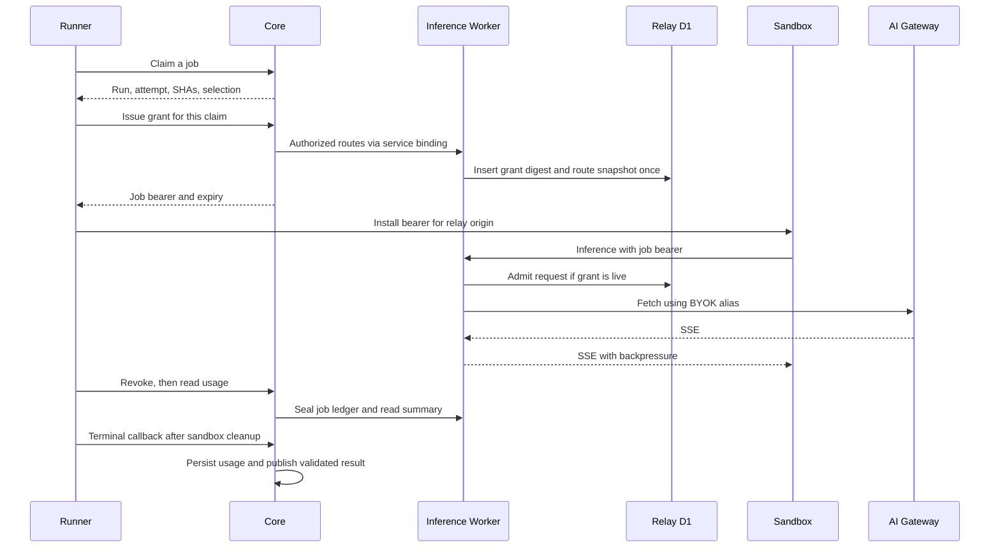

# Move review inference to Cloudflare AI Gateway

**Original migration design for [issue 236](https://github.com/ariga39/compte-rendu/issues/236).** The managed relay now ships. Use the [current deployment guide](../installation.md#configure-the-managed-inference-relay) for new installations.

Original scope: replace the Runner host’s Node LLM service and LiteLLM for the OpenCode Go review workload. Keep one review job, its existing sandbox and one GitHub verdict. An operator must still be able to select a newly discovered model without redeploying or restarting a Runner. Each installation migrates independently.

## What the pilot established

An isolated Core, managed D1, a real sbx Runner and the product GitHub App reviewed a pinned private revision. The sandbox called a Worker over HTTPS. The Worker called an authenticated, BYOK-only AI Gateway over provider-native HTTPS. Two native reviewer sessions started 5 ms apart. A changes-requested review reached the correct commit, the check succeeded, the dashboard projection was anonymous and all counters matched 67 independent request observations. Elapsed time was 29 min 54 s including cleanup and publication. This single run provides no comparative latency or cost benchmark.

The first attempt exercised the failure path. Dropping the configured upstream base path produced HTTP 404, a failed check, a revoked grant and a destroyed sandbox. A fresh job succeeded with the complete URL. The generic AI binding paths tested earlier returned Gateway errors; use the working HTTPS path. The operator injected admission, a temporary socket bridged grant control, and a short-lived Run credential authenticated the Worker. Those are integration points to replace. The pilot used Chat Completions; Responses, subscription OAuth, unattended key rotation and provider billing after disconnect need separate evidence.

## Why D1

The old lease implementation already exposed two operational failure modes. During production execution, an exec timeout ended the caller’s wait while the process continued. The lease alarm destroyed its sandbox first, and normal cleanup of that same lease returned 409. Removing the old DO classes later caused deployment error 10064 until the applied class history was preserved and a retirement migration was deployed. These incidents concern cleanup ordering and class migrations. They do not establish a general storage corruption defect. [Production report #45](https://github.com/ariga39/compte-rendu/issues/45) · [Cleanup fix #47](https://github.com/ariga39/compte-rendu/issues/47) · [Retirement incident #77](https://github.com/ariga39/compte-rendu/issues/77) · [Migration record](cloudflare-durable-object-retirement.md)

Use conditional D1 writes for the three pieces of shared state: grants, request accounting and the model catalog. A normal Worker invocation owns each upstream stream. Revocation closes admission. Each Worker can finish a stream admitted before the revocation transaction. There is no actor library, per-job server, mailbox or alarm scheduler to operate.

## Placement and trust

| Owner                                               | Responsibilities and data                                                                                                                                                                                                                                                                     |
| --------------------------------------------------- | --------------------------------------------------------------------------------------------------------------------------------------------------------------------------------------------------------------------------------------------------------------------------------------------- |
| Existing public application Worker (SvelteKit/Core) | Authenticate existing Runner control traffic, verify job ownership against D1, freeze review selection at admission, accept progress/callbacks, publish GitHub reviews and serve the DB-only dashboard.                                                                                       |
| Instance-specific inference Worker                  | Expose the inference hostname to the sandbox. Accept administrative calls only over a private Worker service binding from Core. Own model routes, live grants, SSE validation and usage observation. Give this Worker only its grant storage, route configuration and Gateway Run credential. |
| Cloudflare AI Gateway                               | Hold upstream keys by reference to Secrets Store, select the configured custom provider and credential alias, forward to the full upstream base URL.                                                                                                                                          |
| Runner and sandbox adapter                          | Issue, revoke and read usage through Core. Install only the job bearer for the exact relay host. The agent retains its model selection, review tools and existing output/correction contract.                                                                                                 |

The separate inference Worker handles untrusted, potentially large model requests without access to GitHub signing keys, the evidence bucket or the review database. This adds one deployment and one service binding per instance. Keep dashboard, ingress and Core in their existing single Worker. Use a dedicated origin for inference so sbx credential substitution and host egress rules do not grant access to unrelated application endpoints.

## Control interface and ownership

Add three POST routes under `/runner-llm/` on the application origin. Apply the existing Runner callback bearer authentication at ingress, strip external verification headers and forbid browser/anonymous access. Core passes typed operations via the private service binding. The relay’s public fetch interface accepts inference only. Never accept a caller-supplied provider URL, alias, upstream key or object name on that interface.

| Operation | Request and result                                                              | Rules                                                                                                                                                                                                                                                          |
| --------- | ------------------------------------------------------------------------------- | -------------------------------------------------------------------------------------------------------------------------------------------------------------------------------------------------------------------------------------------------------------- |
| `issue`   | Run ID, job ID, attempt and requested route IDs → 201 with token and ISO expiry | Require the currently scheduled claim to match all three identifiers. Resolve the frozen one/many reviewer routes using the existing execution rules. Reject extra routes; a reused issuance returns 409. Missing configured routes fail before model traffic. |
| `revoke`  | Job ID → 204                                                                    | Instance-scoped Runner authority. Works after the claim clears, for a job with only a crash marker, or before a delayed issue. Idempotent. Failure prevents a vote and retains the issuer’s recovery marker.                                                   |
| `usage`   | Job ID → existing bounded ModelUsageSummary                                     | Runner authority within the same instance. Available after revoke during retention. Unknown or retired job returns 404.                                                                                                                                        |

For remote mode, make the configured default a Core-owned single route. In the admission INSERT, materialize an effective one-reviewer selection with the current revision whenever the operator selection is null. Explicit selections retain the current atomic snapshot behavior. The remote Runner uses the claim snapshot even if its local default differs. Before switching, finish any already queued legacy null-snapshot jobs on the old backend; new remote claims lacking an effective snapshot must fail before checkout. A test changes defaults after admission and proves that the admitted route still runs. For one selected reviewer, grant only its route. For multiple reviewers, grant the distinct reviewer and synthesis routes. Core owns eligibility; the relay owns knowing whether the IDs resolve. Never infer a route from PR contents. An operator changing the selection uses the current revision CAS; no backfill or rewriting queued jobs.

### Storage and admission

Give the relay its own D1 database per installation. Core’s D1 remains the product system of record. Mixed use of these two databases would give the public inference Worker access to review identities and publication state.

| Table                               | Keys and lifecycle                                                                                                                                                              |
| ----------------------------------- | ------------------------------------------------------------------------------------------------------------------------------------------------------------------------------- |
| `grants`                            | Primary key job ID; unique indexed bearer digest. Store issue/expiry times, frozen route mapping and revocation timestamp. A tombstone for an unknown job has no usable digest. |
| `inference_requests`                | Server-generated request ID primary key and indexed job ID. Store requested route, reported model, pending/complete/incomplete status and bounded numeric counters.             |
| `catalog_routes`, `catalog_refresh` | Unique stable route ID and trusted provider mapping. Separate bounded refresh metadata records the last attempted and complete refresh.                                         |

Generate a cryptographically random base64url bearer and persist only its SHA-256 digest. Bound and hash a presented bearer before an indexed lookup. Invalid input cannot create grant or request rows. An initial valid lookup allows body parsing under the existing size limit. After the upload, admit the selected route with one conditional INSERT … SELECT that checks the same digest, route, expiry and unrevoked state and writes a pending request. Only a successful insert authorizes dispatch. That commit orders the admission relative to revocation. An outbound fetch can start after revocation if its admission committed first. The primary write is the authority for this ordering.

Before issue, durably write a marker containing job ID and trusted issuer identity (transport plus installation/backend generation). Validate issuer against locally configured recovery targets; never take a network destination from marker contents. Treat legacy plaintext markers as belonging to the original local issuer. Startup and maintenance recovery must revoke against the recorded issuer and keep the marker on missing/mismatched configuration. A 204 from a different backend cannot clear it. Require an empty marker directory before starting an older binary that cannot read the new format.

Persist issuance before replying. An ambiguous issue fails the attempt and causes revoke by identity; never retry issue within that job. Unique job identity prevents duplicate issue. Revoke of an unknown job upserts a tombstone retained for the full grant lifetime. Core checks the active claim and passes a short absolute deadline for issue; the guarded insert rejects a delayed issue past that time. A bearer expires four times the shared review attempt budget after issuance, with no renewal. A scheduled bounded sweep deletes expired request rows and grants after their retention window. Authorization checks absolute expiry independently of the sweep.

### What revoke acknowledges

One D1 transaction records revocation and seals pending request rows as incomplete. Once it commits, the relay rejects new admissions and returns 204 without waiting for previously admitted streams. Those streams may finish. Late usage cannot change the sealed snapshot.

The Worker that owns a stream cancels its upstream fetch and reader on client disconnect or absolute grant expiry. Test both events with a streaming client and a controlled upstream. If an isolate dies, its durable pending row becomes incomplete when the grant is sealed. Runner’s current attempt fails without a vote on unconfirmed revoke; Core reports the actual sandbox destruction separately. The issuer-bound marker gates startup recovery and cutover.

## Inference and model discovery

Start with `POST /v1/chat/completions` for OpenCode. Reuse the existing Worker-compatible request restrictions, streaming/error decoder and usage collector from the LLM service. Extract only code exercised by both transports. Authenticate before forwarding, bound the buffered request as today, validate the frozen route/protocol and preserve supported native message, tool and reasoning fields. Force streaming and disable storage as today. Forward the configured upstream model ID. Use server-built headers, server-selected BYOK alias, skip cache and suppress Gateway body logging. Build the Gateway URL from trusted account, gateway and provider configuration. Refuse redirects that could forward credentials to another origin. No request-wide inference deadline, fallback model, hidden retry, intermediate context conversion or added output cap.

A custom provider is registered with its complete HTTPS base URL including any path. The passing configuration used the bare provider slug for the BYOK registration and the prefixed custom provider slug in the request path. Probe both model/tool routes and verify stream completion when provisioning. Preserve sanitized upstream HTTP 400–599 statuses, use 502 for transport failures, and treat premature EOF as incomplete. Never forward arbitrary upstream error text. Runner’s existing session identity, final result, cleanup and callback checks determine publication.

Configure providers once per installation with a stable route prefix, gateway provider slug, credential alias, protocol and catalog source. Keep historical explicit aliases with their original meanings. Preserve IDs such as `review-provider/<native-model>` when moving an installation; the UI may continue displaying just the model name. The upstream receives the native ID. The canonical OpenCode provider identity and any required session headers must work for a custom base URL.

The application Worker's minute cron refreshes the [selectable model catalog](../review-configuration.md#selectable-model-catalog). Each configured provider contributes its last complete list. The picker and settings writes use active candidates; grant issuance uses immutable route mappings. An older queued job therefore retains its original route after withdrawal from discovery. Removing the upstream provider or credential itself still requires checking outstanding jobs and grants.

Read the catalog and its refresh status through the authenticated operator
endpoint `GET /api/review-configuration/catalog`. Neither reading this endpoint
nor issuing a grant makes a synchronous discovery request.

## Accounting, security and failure handling

Count actual upstream attempts per authenticated job, route and reported model. Reuse the existing summary schema, counter semantics and 32-row truncation signal. Record the last native usage snapshot once per request, including partial observations on abort. Count missing model/counters as unknown, preserve reported zero and keep cache/reasoning breakdowns within their parent totals. Sensitive request or response content has no place in accounting. A cache hint has no authority over job attribution.

Finalize each admitted row once with a conditional update from pending and the last usage observed. Complete the D1 update before emitting the success terminator downstream so a normally finished stream is accounted for before Runner revokes. If accounting fails, keep inference success independent of optional telemetry and surface a sanitized accounting warning. Revoke and completion race through D1: a finalizer that loses to sealing cannot alter the snapshot. A request still pending at sealing can have unknown counters even if the upstream later completes it. On ordinary EOF, cancellation or upstream error, save available partial counters while the row remains pending. No writes per token or chunk. Aggregate request rows in D1 by route/model, bound the returned groups and preserve truncation/reporting counts. Runner reads the snapshot after revoke, before the original grant retention deadline. Runner carries that snapshot into its private manifest and terminal callback; Core’s existing owner/attempt and first-write checks persist it in D1. Usage read failure remains observable and best effort. Verify the actual dashboard response for a fresh Worker and a duplicate callback.

| Event                                                               | Required outcome                                                                                                                               |
| ------------------------------------------------------------------- | ---------------------------------------------------------------------------------------------------------------------------------------------- |
| Wrong token, expired grant, ungranted model, cross-instance request | Reject before upstream inference. Never use direct provider credentials as a fallback.                                                         |
| Gateway credential, BYOK alias or upstream model fails              | Return a sanitized error; preserve the known HTTP status through Runner and Core. No successful vote from a partial stream.                    |
| Runner or control network fails during issue/revoke                 | Retain the issuer-bound recovery marker. Gate Runner startup on confirmed revocation. Continue sandbox destruction even when revocation fails. |
| Evidence, cleanup or publication fails                              | Preserve the existing terminal and dashboard semantics, ownership checks and GitHub idempotency.                                               |
| Catalog refresh fails                                               | Keep known routes; unknown routes fail closed. Record refresh age and reason.                                                                  |

Use additive SQL migrations in the separate relay database before deploying a Worker that needs them. Keep the relay database identity stable across code updates and rollback. The existing Core D1 usage schema needs no migration for this transport change.

Use a Cloudflare API token with the account’s AI Gateway Run permission. On the proven provider-native HTTPS endpoint send it in the server-built `cf-aig-authorization` header. Keep it in a Worker secret, separate from provisioning OAuth and BYOK provider secrets. Cloudflare grants Run across every gateway in the account, including their stored BYOK keys. A gateway name or separate token within that account does not isolate credentials from a compromised Run token. Keep the two installations in their respective accounts; verify the account and gateway with a synthetic tool call before rollout. Rotate by installing the replacement, exercising a fresh grant and then revoking the old credential. Test rollback while the old credential is valid. Neither the sandbox nor the Runner receives this credential. Worker and Gateway telemetry must omit request/response bodies, credentials and private repo identity. Existing account access policy governs administrative log access. Budget for upstream tokens, Workers requests/CPU and D1 rows read/written. Before enabling normal concurrency, measure relay requests, active stream seconds, D1 reads/writes and subrequests per invocation under the instance’s configured concurrency. Compare estimated spend and headroom with the operator’s account budget, D1 throughput and Worker subrequest limits. Stop rollout on a quota rejection or an exceeded budget; preserve the sanitized failure and drain back to the local backend.

## Delivery and rollback

The design PR is the first gate. Keep the implementation behind explicit per-instance configuration until a complete live review passes. Implement each slice through a public seam with behavior-first tests and a separate review.

1. **Grant and relay.** Add the inference Worker, private binding interface, relay D1 tables and minimal render/provision support. Use a controlled HTTP upstream to exercise issue/revoke races, expiry, parallel streams, client abort, interrupted SSE and sanitized status. Run two Worker clients over one D1 with a controlled upstream and clock. Revoke from the other client during upload, while waiting for headers and midstream. Verify that a request still uploading is denied admission, a new request is rejected after 204, and completing a previously admitted stream leaves the sealed summary unchanged. Confirm that a sibling job can continue. Terminate one invocation before finalization and verify the incomplete row through the real control endpoint. Trigger the scheduled refresh explicitly in tests. Keep real credential rotation and real PRs as deployment acceptance. No production callers yet.
2. **Catalog and BYOK.** Provision an isolated Gateway/provider and credentials, implement catalog refresh and operator readback. Test a newly listed model becoming selectable without restart, alias precedence, failure retention and frozen routes. Verify real streaming tools plus unattended credential rotation with synthetic inputs.
3. **Core and Runner.** Add authenticated control, server-side ownership checks and an explicit remote transport for the existing grant client. Permit one operator-configured HTTPS origin on port 443 with path `/v1`; reject credentials, redirects, query, fragment and wildcard hosts. Configure sbx secret substitution and egress for precisely this host. Exercise a real claim, cancellation, crash marker recovery, frontend detail read and failed callback. OpenSandbox Vault host substitution and its standard-port FQDN policy require a separate native acceptance before enabling that runtime. Test remote issue, failed revoke and rollback to local: a foreign 204 must leave the marker and the new Runner admission gate closed. Keep OpenShell direct-provider support on its current path.
4. **One installation, then the other.** Provision the account-specific catalog, aliases, Gateway, inference Worker, relay D1, binding and Worker secret. Deploy Core/control first. Drain and verify outstanding recovery markers on the old backend, then switch Runner transport and inference origin together. Respect shared sbx maintenance rules. Use a real PR and confirm head, review URL, check, decision, cleanup, private identity redaction and per-model D1 counters. Observe at ordinary concurrency, including a failed upstream and a cancellation. Repeat independently on the second account. Update installation, operations, security, selection and LLM guides alongside the slices that change them.
5. **Retire the host backend.** Inventory callers and protocols before removing units, credentials or packaging. Existing optional Responses and ChatGPT-subscription routes need an accepted replacement or must stay on their supported local deployment. Chat BYOK with two models does not establish subscription OAuth compatibility. Remove Node/LiteLLM from the migrated installations after rollback acceptance; remove shared source and documentation only when no supported mode still needs it.

Roll back one instance by draining, completing remote revocations and pending markers, restoring the local socket, origin and original aliases together, then resuming with a fresh real job. Keep the old units, credentials and route catalog available through this drill. Do not repoint a live job or a pending marker to a different backend. If revocation cannot be confirmed, leave admission paused, repair the original control path and use the existing cleanup recovery procedure. Stop the pilot relay only after grants and streams retire. Production dashboard history stays in the same D1 throughout the migration.

## References

- [Current LLM contracts and discovery](../llm-service.md)
- [Selection snapshots and operator API](../review-configuration.md)
- [Sandbox rollout and operational recovery](../operations.md)
- [Cloudflare AI Gateway authentication](https://developers.cloudflare.com/ai-gateway/configuration/authentication/)
- [Cloudflare AI Gateway BYOK](https://developers.cloudflare.com/ai-gateway/configuration/bring-your-own-keys/)
