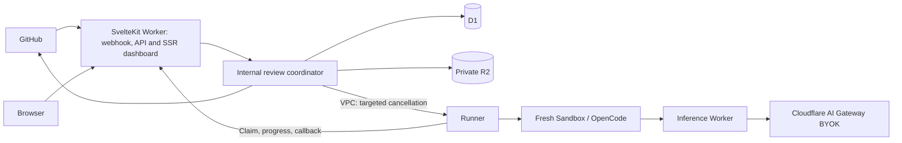

# Architecture and invariants

Compte rendu is a self-hosted GitHub App for static pull-request review outside
GitHub Actions. One admitted review is one durable Core run, one Runner job and
one final GitHub review. Multiple models are participants within that job, not
separate published reviews.

This guide covers the components, trust boundaries, public test seams and
product invariants. Edge-case semantics live in behavior tests. Historical
research and earlier proposals were removed from `main`; see
[#406](https://github.com/ariga39/compte-rendu/issues/406) and the
[archive at e9ba46d](https://github.com/ariga39/compte-rendu/tree/e9ba46dd063c7775e8f86d7514acedc28ae8f40f/docs/archive).

## Components

| Component               | Owns                                                                                                           |
| ----------------------- | -------------------------------------------------------------------------------------------------------------- |
| `apps/ingress`          | GitHub webhook verification, installation filtering and normalization, called inside the SvelteKit Worker      |
| `apps/core`             | Authorization, durable queue, GitHub App access/publication, lifecycle, public projection and metadata refresh |
| `apps/runner`           | Checkout, sandbox lifecycle, agent execution, evidence, grant revocation and terminal callback                 |
| `apps/inference-worker` | Per-job grants, route authorization, cancellation and sanitized transport diagnostics                          |
| AI Gateway BYOK         | Upstream models, URLs, credentials and protocol adaptation                                                     |
| `apps/dashboard`        | Single Worker entry point, SSR SvelteKit/Carbon UI and self-hosted IBM Plex Mono                               |
| `packages/contracts`    | Shared Effect schemas and transport types                                                                      |

Core and ingress are internal modules of one public SvelteKit Worker; only the
allowlisted HTTP endpoints are exposed. The application edge dispatches each
machine or document request once: it authenticates Runner calls, calls typed Core
reads and protocol handlers, and passes GitHub webhook payloads to the ingress
module, which delivers typed events and metadata invalidations directly to Core.
SSR loaders reach the same in-process application through SvelteKit `event.fetch`.

Runner is private. The inference hostname accepts job grants; relay control uses
a private Worker binding. Core validates an admitted job, writes the durable
delivery/run in one D1 claim, and leaves it for the idle Runner to claim through
`/runner-claim`; work is not submitted through the VPC binding. There is no
Cloudflare Workflow or message queue. See [installation](installation.md) and
[LLM service](llm-service.md) for configuration, grants and deployment order.

Core is assembled from admission, Runner protocol, publication/Check update and
public projection seams rather than one monolithic module. D1 access is split by
the transaction that owns it: `ReviewLifecycleStore` (admission, claims,
evidence and publication lifecycle), `CheckRunStore` (Check setup leases),
`CancellationStore` (Runner stop and immediate Check cancellation), and
`DashboardMetadataStore` (public projection, progress and metadata refresh).
`createD1ReviewStateStore` composes the four required ports for existing callers.
Live callbacks are slim and authoritative through D1 ownership and a small
publication record; their private diagnostics arrive through
`POST /runner-evidence`. Core publication never depends on that diagnostic
upload.

## Trust boundaries

| Boundary                                | Control                                                                                             |
| --------------------------------------- | --------------------------------------------------------------------------------------------------- |
| GitHub → public Worker                  | HMAC verification, bounded payload, installation allowlist and event policy                         |
| Maintainer → review admission           | Current GitHub permission and immutable head checks                                                 |
| Dashboard operator → application Worker | GitHub App user session, current GitHub identity, instance UID allowlist and same-origin mutations  |
| Runner → public Worker                  | Authenticated claim, progress, read-token renewal and callback with persisted job/attempt ownership |
| Agent → GitHub                          | Repository-scoped read token injected through the runtime proxy; no publication credential          |
| Agent → model                           | Restricted expiring job grant to the managed inference Worker                                       |
| Inference Worker → AI Gateway           | Account-scoped Gateway Run token and BYOK alias from the frozen grant mapping                       |
| Runner → host resources                 | Per-job runtime ownership, bounded commands, deadlines, redaction and confirmed teardown            |
| Core module → public dashboard          | DB-only projection; unknown/private/expired repository identity removed server-side                 |

The public SvelteKit Worker holds the GitHub App private key and Runner secrets.
Its Core module publishes reviews; it is an internal code boundary, not a separate
private Worker. Only the allowlisted public API, authenticated Runner routes and
signed webhook routes reach that module. The model's result cannot choose the
target repository, commit, URL or publisher; Core checks freshness and agreement
between callback, manifest and Markdown. Publication recovery verifies the App
author, commit and expected review state. See [security](security.md) for the
current controls and their limitations.

## Product invariants

### One admitted review, one durable run

The application edge verifies the webhook HMAC, body bounds and installation
allowlist before delivering a typed normalized event to Core. Automatic review
accepts non-draft `opened`, `reopened`, `synchronize` and `ready_for_review`
events when the base repository is private or the head belongs to the same
repository. Bot authors are excluded unless their stable numeric ID is in
`ALLOWED_BOT_AUTHOR_IDS`; human events and manual requests do not consult that
allowlist.

Public fork PRs and non-allowlisted Bot PRs require `/ai-review` from a user with
current `write`, `maintain` or `admin` permission. Approval binds to the observed
head SHA; a new head needs new authorization. Duplicate deliveries and already
active or completed same-revision reviews do not create another review. Unknown
Checks or uncertain authorization never start work. A retry or manual re-run
creates a fresh run and Sandbox.

### Frozen revision and selection

Core freezes the operator's model selection and revision when admitting a run.
Configuration changes affect new admissions, not queued or running jobs. The
protected [configuration API](review-configuration.md) stores route IDs, not
credentials or URLs; `selection: null` restores the installation default. For
managed inference, Core snapshots `RELAY_DEFAULT_MODEL_ROUTE` as a single-reviewer
selection at admission.

One explicit reviewer runs directly; multiple reviewers use a supervisor and
selected subagents in one Sandbox. Every participant receives the same review
task and final output contract. The supervisor dispatches one independent review
per participant and then synthesizes them; child exports are best-effort
evidence, not extra result gates. The job retains its frozen selection and
`multi-review.json`, with one callback and one publication. The LLM grant permits
only the routes the job needs. Cancellation revokes that grant and destroys the
shared Sandbox.

### Single publisher and freshness

Core is the only GitHub publisher. It derives the repository, PR and commit from
the admitted run, rechecks the head, and uses a publication claim plus run marker
to suppress duplicates. Marker recovery verifies the App author, commit and
review state against the expected publication. A changed head is superseded
without a stale vote. GitHub reads and the subsequent POST are not atomic; an
ambiguous response is not proof that no review was published.

Check setup and terminal Check updates are best effort. A GitHub error can leave
a Check showing an earlier state; late setup and later callbacks make a fresh
direct attempt from the persisted run status and decision. Core never creates
another Check or review for the same run and never regresses a terminal Check.
Manual cancellation sends its Check update immediately; only its Runner stop
keeps durable retry work. Cancellation and publication compete for durable
ownership of the same run: a cancelled run publishes no review and is not a
failure.

### Clean break per run

Each run gets a fresh Sandbox and immutable base/head SHAs; work never resumes in
a used Sandbox. A run ends in a terminal product state and eventual Sandbox
destruction. A retry creates a fresh sandbox and uses immutable SHAs.

A known cleanup failure blocks later reviews for the same PR until exact
destruction is confirmed; elapsed time never releases it. An unknown pending
cleanup follows the original claim budget so a lost Runner cannot deadlock the
PR. Runner-owned resources are age-swept only after the attempt budget plus a
finalization margin, using a reserved parseable name, complete inventory and
post-removal absence verification; a physical sweep never changes Core state. A
lost in-flight or undelivered review can be re-triggered in a fresh Sandbox once
same-PR admission is eligible. See
[troubleshooting recovery](operations.md#operations-and-troubleshooting).

### Fail-closed boundaries, best-effort side channels

Reject uncertain authorization, revision freshness, credential handling, agent
output and cleanup. Invalid input cannot authorize publication or silently switch
models. Check, progress, telemetry and diagnostic-evidence delivery are best
effort and must not become execution or publication gates. Do not extend
fail-closed into unrelated speculative controls.

### Data ownership and privacy

Core/D1 owns product state, ownership, lifecycle timestamps, decision, frozen
model selection, bounded per-model token summaries, repository disclosure
metadata and evidence object metadata. Runner owns observations about local
execution. The terminal callback carries the validated result and an evidence
reference; private R2 archives retain named manifest/JSONL/stderr/Markdown/root-
session diagnostics, and the Runner host retains fuller recovery evidence. D1
does not store raw repository contents, credentials or session transcripts.
Public dashboard reads use D1 only and trigger no GitHub or Runner request; only
currently verified public identity is disclosed, and private, unknown or expired
identities stay anonymous. See [dashboard behavior](public-dashboard-design.md).

## Runner job and sandbox boundary

**Ownership and authorization.** Core/D1 owns the durable job: admitted
revision, attempt, persisted owner, publication state and the record the next
release depends on. Runner owns local execution: checkout, the sandbox backend,
the agent process, observations and private evidence. Ingress authenticates
claim, progress, read-token renewal, callback and private evidence upload with
`RUNNER_CALLBACK_TOKEN`; every report must match the persisted job and attempt
owner. `POST /runner-claim` returns an immutable `RunnerJobInput` only when Core
has eligible work.

**Isolation and destruction.** Runner selects one sandbox backend at startup.
The backend implements the job-sandbox contract (`setup`, `exec`, `copyOut`,
optional read-token refresh, `destroy`) and owns its executable/environment,
credentials/egress and confirmed teardown; Runner retains budgets, aborts,
redaction, diagnostics and product lifecycle. Unknown or retired kinds and
incomplete configuration fail before claims; there is no silent fallback, and a
new backend changes no Core or public contract. See [security](security.md) for
backend assumptions and isolation limits.

Repository text and GitHub context are untrusted evidence. The agent is
read-only: no repository programs, builds/tests, edits, commits or publication.
OpenCode loads the job configuration and bundled skills from a private read-only
configuration directory. The Runner excludes repository configuration and host
skills, MCP and SSH settings; budgets and egress are enforced outside the model,
because a prompt is not a security boundary. The bundled `code-review` skill owns
only the review method and cannot change scope, tool permissions, orchestration
or the final output contract. Its method lineage, credits and licenses are
packaged with it; the decision to replace the earlier topic-skill proposal is
recorded in the
[archived source comparison](https://github.com/ariga39/compte-rendu/blob/e9ba46dd063c7775e8f86d7514acedc28ae8f40f/docs/archive/review-oriented-skills-research.md)
and [#406](https://github.com/ariga39/compte-rendu/issues/406).

Core's VPC stop requests cancellation of a reachable job. A missing or retired
job is not proof of destruction: only Runner can confirm destruction for a job it
still tracks, or from a backend's exact absence proof. Core never releases a
known failed cleanup from elapsed time or a stop response alone. Capacity and
maintenance controls affect new claims only and never revoke admitted ownership.
Core D1 owns the deployment's desired Runner concurrency, editable in Dashboard
Settings; `RUNNER_CONCURRENCY` is the startup fallback. Runner reads the target
through an authenticated `HEAD /runner-claim` probe that allocates no work.
Increases wake claims, decreases preserve admitted jobs and reservations, and a
missing or invalid value leaves the last target unchanged. Claims are
single-flight, so an ambiguous response cannot create a second owner.
A lost callback is not replayed or reconstructed locally; recovery is a fresh
review. See [maintenance operations](operations.md#drain-before-maintenance) and
[recovery](operations.md#operations-and-troubleshooting).

**Evidence and publication.** The terminal callback (`POST /runner-callback`) is
the publication authority and carries the validated result. Diagnostic evidence uploads through
`POST /runner-evidence` are separate, bounded best effort: a missing, late,
oversized or partial archive never changes a verified result or publication
state. Core's small publication record still requires the shared bucket, so a
bucket outage delays callback acceptance without turning diagnostic evidence into
a gate. Upload bounds, retention and cleanup confirmation procedures are in
[operations](operations.md#publication-and-private-diagnostics).

## Deployment and compatibility

Compte rendu is self-hosted for a single operator. Upgrade the Worker and Runner
together in a maintenance window; mixed-version rolling compatibility is not a
default requirement. Protocol, field and disk-format removals are deliberate
breaking changes. Do not add an indefinite fallback unless explicitly accepted; a
temporary compatibility path needs a concrete reason, removal date and cleanup
issue.

A rare lost in-flight or undelivered review during an upgrade or crash is
acceptable. Re-trigger it in a fresh Sandbox once same-PR admission is eligible:
an expired pending claim, or confirmed destruction after `cleanup=failed`.

## Public test seams

Tests observe public behavior through these established seams:

| Seam                              | Observable behavior                                                                                                   |
| --------------------------------- | --------------------------------------------------------------------------------------------------------------------- |
| GitHub webhook ingress            | Signature/payload/installation checks, normalization, typed delivery and retry response                               |
| Application edge HTTP with D1     | Runner authentication and limits, public reads, durable admission/claim, callback/progress ownership across instances |
| Core typed service                | Admission events, metadata invalidation, Runner protocol results, publication and public projection                   |
| Review coordinator                | Policy, deduplication, freshness, terminal publication through external adapters                                      |
| Runner HTTP/process/runtime ports | Admission, capacity, agent result, evidence, deadlines and confirmed cleanup                                          |
| LLM control/inference HTTP        | Grants, route authorization, native streaming, cancellation and sanitization                                          |
| Core store ports                  | Persisted run/disclosure queries and atomic ownership transitions by transaction owner                                |
| Built dashboard in browser        | Navigation, filters, privacy expiry, refresh and accessibility                                                        |

Use behavior-based TDD with narrow external adapters, not private-helper or
internal-call-order assertions. Runtime code follows the pinned stable Effect 4 and
[Effect guidance](https://github.com/Effect-TS/skills). Vite+/pnpm supply the locked
toolchain. See [local runtime tracer](local-runtime-tracer.md) for workerd coverage.

Output-contract changes require a pinned real OpenCode executable against a
scripted provider, including invalid output followed by same-session correction,
then Runner→Core publication acceptance. Production reviews do not substitute for
this compatibility check; a broken product review path cannot gate its own fix.
`tests/support/github-publication-shim.ts` and
`scripts/github-publication-probe.mts` capture writes locally for unpublished
probes. Real GitHub publication is needed when publication behavior changes.

A terminal state and eventual Sandbox destruction are the product objective, not
proof of crash recovery. Keep missing behavior in issues rather than describing
it as delivered. Merge bounded changes when their main behavior is correct and
reviewed; non-critical findings become follow-up issues.
