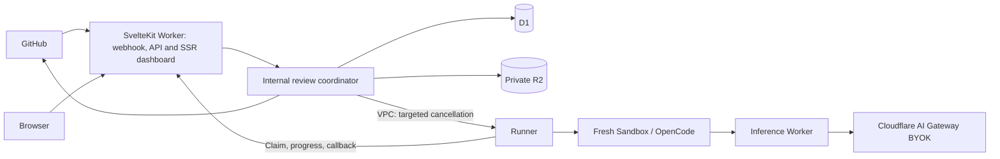

# Architecture and behavior

Compte rendu is a GitHub App for static pull-request review outside GitHub Actions.
One admitted review is one durable Core run, one Runner job and one final GitHub
review. Multiple models are participants within that job, not separate published
reviews. This document describes the implementation; historical proposals are in
[the archive](archive/README.md).

## Product behaviour

### Admission

Ingress verifies the webhook HMAC, body bounds and installation allowlist before
forwarding a normalized event to Core. Automatic review accepts non-draft
`opened`, `reopened`, `synchronize` and `ready_for_review` events when the base
repository is private or the head belongs to the same repository. Bot authors
are excluded unless their stable numeric ID is in `ALLOWED_BOT_AUTHOR_IDS`.
Human events and manual requests do not consult that Bot allowlist.

Public fork PRs and non-allowlisted Bot PRs require `/ai-review` from a user with
current `write`, `maintain` or `admin` permission. Approval binds to the observed
head SHA; a new head needs new authorization. Manual feedback uses GitHub
reactions: `eyes` for admission, `confused` for denial or a draft, and `-1`
for an admitted run that fails. Supersession during completion also adds
`confused`; a queued run superseded before execution can have only its Check updated. The published review is the success signal.

`check_run.rerequested` and `check_suite.rerequested` can retry a failed or manually cancelled review
under the same current maintainer checks. Manually cancelled Checks also offer
**Run review again** through the App’s `check_run.requested_action` handler. A retry creates a fresh run and Sandbox.
Duplicate deliveries and already active/completed same-revision reviews do not
create another review. Unknown Checks or uncertain authorization never start work.

### Checks and publication

Check setup is best effort after durable admission, outside the webhook response
path. Its D1 ownership lease prevents concurrent setup; late setup catches up to
the persisted run. Check failure does not prevent execution or terminal feedback.
A Check is queued until claim, in progress after claim, and successful only after
publication. On failure, Core requests a failed Check. A GitHub update error can leave the Check showing an earlier state. Supersession and manual cancellation complete it as cancelled, with distinct explanations.
`details_url` points to that run's dashboard page. The configurable Check name
also supplies the dashboard title. A terminal Check update that GitHub temporarily
rejects leaves durable D1 delivery work for the exact existing Check. The scheduled
handler retries it from the persisted run status and decision; late setup and
duplicate callbacks use the same path. Reconciliation never creates another Check
or review, never regresses a terminal Check, and rotates bounded sweeps by last
attempt so one unavailable Check cannot starve later runs. Manual cancellation keeps
its separate reconciliation timestamps.

Core is the only GitHub publisher. It derives repository, PR and commit from the
admitted run, rechecks the head, and uses a publication claim plus run marker to
suppress duplicates. Marker recovery verifies the App author, commit and review
state for both structured results and legacy comment-only reviews. A changed head is superseded without a stale
vote. GitHub reads and the subsequent POST are not atomic; an ambiguous response
is not proof that no review was published.

### Review result

OpenCode 2 returns one final assistant submission with a first line
`DECISION: <decision>` (`approve`, `request_changes`, `comment`), one blank line,
then the non-empty, bounded review as raw Markdown. The earlier
`{decision, markdown}` JSON object remains accepted for compatibility. Runner
extracts the submission from the completed session export, checking exact
session/model/agent identity, successful outcome, final assistant `stop` and final
successful `idle`. Intermediate analysis and tools are not results. There is no
custom submission tool.

A normally completed session with a missing or invalid final submission can
receive one correction in the same live Sandbox, session, model and agent. Both
calls share the original deadline. Abort, timeout, truncation, abnormal completion
or ambiguous session identity do not authorize correction. After any live
correction, Runner revokes the model grant, exports and redacts evidence, and
validates the archived final result before destruction. Unresolved invalid output
publishes no vote; Runner does not repair malformed JSON or extract result
substrings from prose, and never infers a decision.

The shared prompt asks for concise, adversarial review of necessity, correctness
and implementation cost, starting with `TLDR:`. These are instructions, not
schema checks. A different heading does not invalidate a structural result.

Runner carries `{version: 2, decision, markdown}` in its callback and manifest;
Core checks agreement with the exact Markdown artifact before mapping the vote to
`APPROVE`, `REQUEST_CHANGES` or `COMMENT`. A delivered Request changes review is
successful execution. Historical string results retain COMMENT behavior and an
unknown decision; their text is not reclassified. A new round attempts to dismiss this
installation’s earlier GitHub approvals/change requests on the PR, with mandatory confirmation before Runner
admission, preserving historical decisions and review discussion. A failed claim-time reset
is recorded as `review_reset_failed` and cannot admit the new round. See [review decisions](review-decisions-design.md).

## Deployment shape

| Component               | Owns                                                                                                                       |
| ----------------------- | -------------------------------------------------------------------------------------------------------------------------- |
| `apps/ingress`          | Webhook verification, installation filtering, request authentication and normalization, called inside the SvelteKit Worker |
| `apps/core`             | Authorization, durable queue, GitHub App access/publication, lifecycle, public projection and metadata refresh             |
| `apps/runner`           | Checkout, sandbox lifecycle, agent execution, evidence, grant revocation and terminal callback                             |
| `apps/inference-worker` | Per-job grants, route authorization, cancellation and sanitized transport diagnostics                                      |
| AI Gateway BYOK         | Upstream models, URLs, credentials and protocol adaptation                                                                 |
| `apps/dashboard`        | Single Worker entry point, SSR SvelteKit/Carbon UI and self-hosted IBM Plex Mono                                           |
| `packages/contracts`    | Shared Effect schemas and transport types                                                                                  |

Core and ingress are internal modules of one public SvelteKit Worker; only the
allowlisted HTTP endpoints are exposed. Runner is private. The inference hostname accepts job grants; relay control uses a private Worker binding. Core validates an admitted job, writes the durable delivery/run in one D1 claim, and leaves it for the idle Runner to claim through `/runner-claim`; work is not submitted through the VPC binding.
There is no Cloudflare Workflow or message queue. See [installation](installation.md)
and [LLM service](llm-service.md) for configuration, grants and deployment order.

## Runner Job and pull interface

`POST /runner-claim` returns an immutable `RunnerJobInput` or 204. Ingress
protects claim, progress and callback with `RUNNER_CALLBACK_TOKEN`. Core atomically
claims an eligible scheduled row, records job identity/attempt, then resolves the
repository and mints a repository-scoped read token. Progress and callbacks must
match that persisted owner. Core's VPC `DELETE /jobs/:id` cancels reachable jobs.

Core/D1 owns review history, including the accepted outcome, evidence reference
and cleanup status. Read completed reviews through the dashboard API by run ID.
The Runner owns observations about local execution. A cancellation request in
D1 can win while sandbox destruction or callback delivery is still outstanding.
A missing job on a Runner gives Core no proof of destruction. A stop received while Runner still tracks the job can confirm destruction for
the exact job ID, run ID and attempt. After retirement, a stop returns 404 and
cleanup remains unconfirmed. Later reviews can proceed when the claim budget expires.

Runner reserves capacity for in-flight claims and holds slots through archival,
cleanup and callback delivery. It fills `RUNNER_CONCURRENCY` (positive integer,
default 1); malformed startup configuration fails before admission. An optional
TOML `RUNNER_SETTINGS_FILE` overrides concurrency and reloads through smol-toml,
chokidar and Effect Schema. Invalid updates retain the last good value; increases
wake claims and decreases preserve admitted jobs/reserved claims. Other settings
are not hot-reloaded. Claims are single-flight; ambiguous claim responses halt
polling rather than risk duplicate ownership.

Authenticated private maintenance endpoints pause new claims
without cancelling jobs or in-flight claim reservations. At startup Runner scans
its pending grant markers and revokes each recorded grant through the marker's
original issuer/generation. The admission and claim gate stays closed, and drain
cannot report complete, while that startup scan has any failed, invalid or
foreign marker. Resume changes only the maintenance pause. It may retry the
Sandbox ownership scan but never retries or clears the startup grant scan. Exact
cleanup recovery can resolve an eligible failed cleanup and retry the sandbox
scan, but it rejects invalid and foreign markers and is limited to sbx or
microsandbox jobs whose retained evidence and callback still show
matching failed cleanup; see [maintenance operations](operations.md#drain-before-maintenance).
A successful startup scan is not continuous. A terminal revocation failure after
startup fails that job without a vote and leaves its marker without closing
admission or claims in that process. The marker remains for the next startup scan
or matching recovery. Grants have a fixed lifetime of four review budgets: the
token stops authenticating at expiry, but expiry alone does not resolve the
marker or the next startup gate. Drain status includes work through cleanup and
callback delivery; unconfirmed Sandbox cleanup or a halted claim loop prevents a
drained report. This pause is in-memory and resets on process restart.

Runner retains the final callback body privately before bounded delivery when
the evidence directory is available. An
explicit authenticated `POST /maintenance/replay-callback` replays it only after
matching the operator's job/run/attempt, evidence ID and immutable SHAs and
validating artifact integrity and confirmed cleanup. This works across Runner
restarts; it does not reconstruct old callbacks or rerun agent work. Core's
existing callback ownership, revision freshness and publication reconciliation
remain authoritative. Acceptance is distinct from publication. There is no
automatic replay queue; see [callback recovery](operations.md#replay-a-lost-terminal-callback).

Jobs for the same repository/PR remain serialized until the prior Sandbox is
confirmed destroyed. Unrelated PRs may progress. Each job checks immutable base
and head commits, derives a merge base, and performs GitHub-read preflight before
OpenCode starts. Checkout disables hooks, submodules and LFS smudge and removes
the authenticated remote before agent execution.

The shared review attempt budget is 90 minutes from Core's durable claim
timestamp, including setup. Queue time is free. Runner receives the absolute deadline. The sbx and microsandbox backends refresh the GitHub read token for the same claimed job and repository before expiry. A failed refresh limits execution to the existing credential expiry minus one minute. It reports whether the claim deadline or the credential
ended a timeout. Setup consumes the same remaining budget; there is no
agent-start reset. One same-session correction gets at most two minutes of its
remainder; it is not another attempt. Evidence archival, revocation,
destruction and callback keep independent bounded finalization time. Callback
delivery has a bounded timeout and one immediate retry. An oversized evidence
bundle becomes a small terminal incomplete-evidence failure, not truncated
successful evidence.

Normal success, failure, timeout and cancellation finalize evidence and destroy
the Sandbox before callback. A Runner crash can interrupt a review before it delivers a verdict.
On a later admission or claim attempt, Core expires an abandoned claim after
its original 90-minute budget. A fresh run for the same PR can then proceed.
Runner reconciles owned sbx and microsandbox resources independently.

## Multi-model review jobs

Core freezes the operator's model selection and revision when admitting a run.
Configuration changes affect new admissions, not queued/running jobs. The protected
[configuration API](review-configuration.md) stores route IDs, not credentials or
URLs. `selection: null` restores the installation default. For managed inference, Core snapshots `RELAY_DEFAULT_MODEL_ROUTE` as a single-reviewer selection at admission.

One explicit reviewer runs directly; multiple reviewers use a supervisor and
selected subagents in one Sandbox. The same Runner-owned review task and final
output contract is supplied directly to one reviewer or through each
multi-review child's agent system prompt. The compact supervisor prompt names
the frozen roster and requests one independent review per participant, in
parallel using foreground tasks with one fixed short instruction, followed by
synthesis after all reviewers return. The supervisor keeps the final output
contract but does not repeat the trusted task it dispatches. It forbids
follow-up reviews and verification rounds. Runner does not impose an internal
workflow, coverage ledger or child submission protocol. Child exports are
best-effort evidence, not extra result gates. The job retains frozen selection
and `multi-review.json`, with one callback and one publication.

The LLM grant permits the routes actually needed by the job. One-reviewer jobs do
not grant an unused synthesis route. Cancellation revokes that grant and destroys
the shared Sandbox: closing an OpenCode client does not stop its server sessions.
This selection/service path supports sbx and microsandbox.

## Sandbox runtime modules

Runner builds one instance-level sandbox backend once at startup. Each backend
validates its own configuration, owns its executable/environment, readiness and
outage state, ownership records, orphan reconciliation and any cleanup-absence
proof. The Runner only asks for `health`, `checkReady`, `reconcileOrphans`,
optional `confirmCleanupAbsent` and per-job sandboxes. Adding a backend means
adding one implementation and one registration; Runner, Core and the public
contract stay unchanged.

Each job gets a `JobSandbox` with `setup`, `exec`, `copyOut`, optional
`updateGithubReadToken` and `destroy`. It owns backend commands,
credentials/egress, host resources and confirmed teardown; Runner retains
budgets, aborts, redaction, diagnostics and product lifecycle. Metadata is updated
as resources are created so partial setup can still be archived and cleaned.

- **sbx (default):** pinned custom image, `shell` launcher and cloned workspace.
  The shell kit avoids the built-in OpenCode kit's implicit network allowances.
  Explicit per-job rules rely on the host's deny-all policy and absence of other
  global/organization allows. Direct-model mode uses host secret resolution;
  service mode injects a short-lived job grant instead of an upstream key.
- **microsandbox:** a local KVM microVM with read-only staging, per-job TLS credential injection and HTTPS-only destination rules. Cleanup verifies ownership and absence in the original catalog. See the [microsandbox installation guide](microsandbox.md).

Runtime selection is startup configuration. Unknown or retired kinds and
incomplete runtime configuration fail before claims; no silent fallback to sbx
occurs. Recorded milestones carry a bounded lowercase identifier, so a new
backend does not require a Core contract deployment. See
[security boundaries](security.md) for backend-specific assumptions.

## Credentials and evidence

The GitHub App private key stays in Core. Runner receives one short-lived token
limited to the target repository and read permissions, used for checkout and the
runtime's GitHub proxy. Sandbox agents see a proxy placeholder, not the real
GitHub credential. Cleanup removes the job's credential sources and scoped rules.

In LLM service mode, supplier credentials stay in the installation’s Cloudflare account; Sandbox inference uses
a job grant valid for four review budgets, with no renewal. Grant revocation and
Sandbox cleanup are independent. An unconfirmed revocation fails the job even
when Sandbox destruction succeeds. Direct-model and managed service modes have
the separate credential paths documented in the installation guide.

Repository text and GitHub context are untrusted evidence. The agent is read-only:
no repository programs, builds/tests, edits, commits or publication. Fresh
standalone OpenCode configuration excludes repository config and host
skills/MCP/SSH settings. Resource/time limits and egress are enforced outside the
model; a prompt alone is not a security boundary.

`apps/runner/src/review-prompt.ts` owns the task contract: exact revisions,
GitHub context collection, static inspection limits, reviewer orchestration and
final output. A single reviewer receives the full contract directly; every
multi-review child receives the same contract through its configured system
prompt, while the supervisor receives only the fixed dispatch instruction,
synthesis rules and final output. The format-correction reminder reuses the
same output requirements.

The bundled `code-review` skill owns the review method: contextual reading,
premise and simplicity challenges, broad inspection directions, and evidence-based
finding criteria. It combines OpenCode's review command and Codex's review rubric, with boundary,
interaction and test-assessment principles from Vercel and Sentry.
There are no separate topic skills. Each independent reviewer is instructed to
load it through OpenCode's native skill tool; the synthesizer only combines the
supplied reviews and does not load skills or re-inspect code. The skill cannot
change scope, tool permissions, orchestration or the final output contract.
Repository and PR text remain untrusted evidence, not overriding instructions.
If the skill cannot be loaded, the reviewer reports the limitation rather than
claiming a complete review; it does not fetch or install a replacement.

The standalone Runner embeds the skill's Markdown, license and attribution
notice, and stages them under the job's isolated
`XDG_CONFIG_HOME/opencode/skills/code-review/` before Sandbox setup. Every runtime
receives the same resources through its existing config mount/upload. No source
checkout is required on the Runner host.

`SKILL.md` credits the upstream authors, pins the source revisions and describes
the adaptation. `LICENSE.md` preserves the OpenCode MIT and Codex Apache-2.0
licenses, plus the Vercel MIT and Sentry Apache-2.0 licenses; `NOTICE.md` documents the modified synthesis. The adaptation is
Apache-2.0 with the MIT notice retained; unrelated application code is unaffected.
The [source comparison](archive/review-oriented-skills-research.md) records why
this replaced the earlier topic-skill proposal.

D1 stores product state, ownership, lifecycle timestamps, decision, frozen model
selection, bounded per-model token summaries, repository disclosure metadata and evidence object metadata. It does
not store raw repository contents, credentials or session transcripts. The bounded
callback contains named manifest/JSONL/stderr/Markdown/root-session evidence;
private R2 retains that bundle. The host retains fuller recovery evidence,
including child sessions and OpenCode state. Public dashboard APIs expose neither. After grant revocation, Runner collects native
service usage and carries it through the owned terminal callback. Core stores the
first summary once; dashboard details read it from D1. Unknown/partial statistics
do not become zero and are not publication gates. See [usage semantics](llm-service.md#per-job-model-and-token-usage).

## Public dashboard

[Dashboard behavior](public-dashboard-design.md) defines overview, filtered history,
detail drawers, privacy and refresh. Every public read uses D1 only and triggers
no GitHub or Runner request. Core refreshes repository metadata independently via
its scheduled handler. Signed-in operators can edit the review roster and cancel runs before publication starts. Cancellation and publication compete for durable ownership of the same run. The Worker retries the GitHub Check update and Runner stop independently. See [operator cancellation](operations.md#operator-cancellation). Only currently verified public identity is disclosed;
private, unknown or expired identities are anonymous.

Status is product state; assignment and stage timestamps are observations, not
proof of process liveness. Review decision and cleanup remain separate. TanStack
Svelte Query owns adaptive polling, focus/reconnect refresh and ephemeral cache;
there is no websocket or persisted browser response cache.

## Fail-closed rules

Reject uncertain authorization, revision freshness, credential handling, agent
output and cleanup. Invalid input cannot authorize publication or silently switch
models. Cleanup failure keeps same-PR replacement blocked until destruction is
confirmed. Check/analytics/progress delivery is best effort and must not become
an execution gate. Do not extend fail-closed into unrelated speculative controls.

## Deep modules and test seams

Tests observe public behavior through these established seams:

| Seam                              | Observable behavior                                                                                             |
| --------------------------------- | --------------------------------------------------------------------------------------------------------------- |
| Webhook ingress HTTP              | Signature/payload/installation checks, normalization and retry response                                         |
| Core Worker HTTP with D1          | Durable admission/claim, callback/progress ownership, publication and public projection across Worker instances |
| Review coordinator                | Policy, deduplication, freshness, terminal publication through external adapters                                |
| Runner HTTP/process/runtime ports | Admission, capacity, agent result, evidence, deadlines and confirmed cleanup                                    |
| LLM control/inference HTTP        | Grants, route authorization, native streaming, cancellation and sanitization                                    |
| Store query interface             | Persisted run/disclosure queries and atomic ownership transitions                                               |
| Built dashboard in browser        | Navigation, filters, privacy expiry, refresh and accessibility                                                  |

Use behavior-based TDD with narrow external adapters, not private-helper or
internal-call-order assertions. Runtime code follows the pinned stable Effect 4 and
[Effect guidance](https://github.com/Effect-TS/skills). Vite+/pnpm supply the locked
toolchain. See [local runtime tracer](local-runtime-tracer.md) for workerd coverage.

Output-contract changes require a pinned real OpenCode executable against a
scripted provider, including invalid output followed by same-session correction,
then Runner→Core publication acceptance. Production reviews do not substitute for
this compatibility check; a broken product review path cannot gate its own fix.
`tests/support/github-publication-shim.ts` and
`scripts/github-publication-probe.mts` capture writes locally for unpublished
probes. Real GitHub publication is needed when publication behavior changes.

A terminal state and eventual Sandbox destruction are the product objective,
not proof of crash recovery. Keep missing behavior in issues rather than describing
it as delivered. Merge bounded changes when their main behavior is correct and
reviewed; non-critical findings become follow-up issues.

### Startup ownership reconciliation

For sbx, the adapter retains a private ownership record under
`<evidenceRoot>/sandbox-owners/<instanceId>/` before creating each scoped
resource. `instanceId` comes from `RUNNER_INSTANCE_ID` or, by default, the
configured listener port, so co-located Runners sharing an evidence root still
have separate records. The record contains the Job identity, exact Sandbox name,
the per-job host workspace/config paths and which setup steps were attempted; it
contains no repository content, model output, sessions or credentials. On
startup the Runner checks each recorded name with `sbx inspect --json`. A present
Sandbox is removed only when the
inspection's exact `name` matches and its `workspace` or an
`additional_workspaces[].dir` equals the retained host path. Runner then removes
only network policies whose `sandbox_id` and resources match the recorded
attempted rules, the exact Sandbox, and the recorded scoped secrets. It verifies
Sandbox and policy absence plus the native `sbx secret ls --json` postcondition
before clearing the record. An absent Sandbox is treated as interrupted setup:
only steps recorded as attempted before the interruption are reconciled. An
intent recorded before creation cannot authorize deleting a same-name Sandbox or
its policies. A missing, foreign, malformed or unverifiable identity keeps the
record and leaves resources untouched. Names, prefixes and unrelated inspect metadata never establish ownership.
For microsandbox, Runner checks the original catalog, exact VM name and owner
nonce. Both adapters retry unresolved ownership records automatically and skip
live jobs. A backend outage can delay cleanup while other jobs proceed.
Recovery diagnostics identify the job, step and command status and omit stderr.

### Failed-cleanup reconciliation

An authenticated Runner maintenance operation can reconcile a failed sbx or
microsandbox run whose original host-directory cleanup was
confirmed and whose exact Sandbox is now absent. The configured backend receives
the recorded backend-owned recovery proof and rechecks its policies/secrets or
its original catalog identity. It revokes the
job grant before reporting recovery. Original terminal evidence remains immutable;
separate local and R2 recovery records provide the audit trail. Core matches the
failed, superseded or cancelled run, job, attempt and immutable SHAs before
confirming cleanup. Destroyed cleanup is monotonic under delayed callbacks. The
queued-task projection exposes an anonymous cleanup-block reason only when an
unresolved terminal same-PR run blocks claiming.

After an in-process sbx access outage, Runner pauses new claims and automatically
repeats the same retained-evidence and exact-absence recovery without blocking
unrelated claims. When access returns, affected jobs become immediately eligible.
A transient report or verification failure retries the expensive check no more
than once every 30 seconds per pending job. A Core 409 on the cleanup report
can indicate that the original terminal callback has not arrived. Runner replays the
retained verified callback and immediately retries the same report once. A
repeated 409 is permanent. After that, only 408/429/5xx or timeout/network
failures remain retryable; other 4xx responses or a permanent callback rejection
stop automatic delivery with bounded job/run/status diagnostics. When exact absence fails because
the owned Sandbox still exists, Runner runs the ownership reaper scoped to that
job before the next attempt; other ownership records are skipped. Already-absent
evidence keeps the normal verification and report path. The terminal verdict is
unchanged and completed work never restarts. While the job is in memory, Runner can report verified cleanup using its retained
manifest and callback. After a restart the ownership scan removes verified orphan
resources. Core can still show unconfirmed cleanup until an exact callback arrives.
Later reviews become eligible after the original 90-minute claim budget, including
when a restart loses an in-memory staged claim request ID. Legacy evidence lacking host
confirmation, unknown retired-backend identity and retired-backend recovery remain
outside this operation; see the operations guide.
