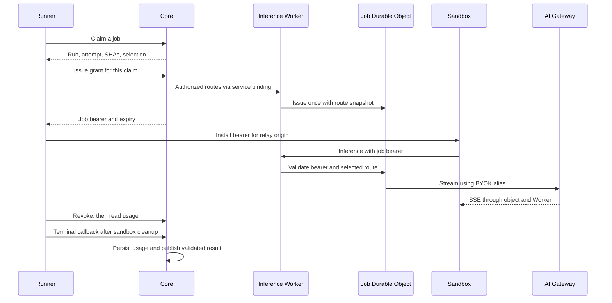

# Move review inference to Cloudflare AI Gateway

**Proposal for [issue 236](https://github.com/ariga39/compte-rendu/issues/236).** Replace the Runner host’s Node LLM service and LiteLLM for the OpenCode Go review workload. Keep one review job, its existing sandbox and one GitHub verdict. An operator must still be able to select a newly discovered model without redeploying or restarting a Runner. Each installation migrates independently.

## What the pilot established

An isolated Core, managed D1, a real sbx Runner and the product GitHub App reviewed a pinned private revision. The sandbox called a Worker over HTTPS. The Worker called an authenticated, BYOK-only AI Gateway over provider-native HTTPS. Two native reviewer sessions started 5 ms apart. A changes-requested review reached the correct commit, the check succeeded, the dashboard projection was anonymous and all counters matched 67 independent request observations. Elapsed time was 29 min 54 s including cleanup and publication. This single run provides no comparative latency or cost benchmark.

The first attempt exercised the failure path. Dropping the configured upstream base path produced HTTP 404, a failed check, a revoked grant and a destroyed sandbox. A fresh job succeeded with the complete URL. The generic AI binding paths tested earlier returned Gateway errors; use the working HTTPS path. The operator injected admission, a temporary socket bridged grant control, and a short-lived Run credential authenticated the Worker. Those are integration points to replace. The pilot used Chat Completions; Responses, subscription OAuth, unattended key rotation and provider billing after disconnect need separate evidence.

## Placement and trust

| Owner                                               | Responsibilities and data                                                                                                                                                                                                                                                                     |
| --------------------------------------------------- | --------------------------------------------------------------------------------------------------------------------------------------------------------------------------------------------------------------------------------------------------------------------------------------------- |
| Existing public application Worker (SvelteKit/Core) | Authenticate existing Runner control traffic, verify job ownership against D1, freeze review selection at admission, accept progress/callbacks, publish GitHub reviews and serve the DB-only dashboard.                                                                                       |
| Instance-specific inference Worker                  | Expose the inference hostname to the sandbox. Accept administrative calls only over a private Worker service binding from Core. Own model routes, live grants, SSE validation and usage observation. Give this Worker only its grant storage, route configuration and Gateway Run credential. |
| Cloudflare AI Gateway                               | Hold upstream keys by reference to Secrets Store, select the configured custom provider and credential alias, forward to the full upstream base URL.                                                                                                                                          |
| Runner and sandbox adapter                          | Issue, revoke and read usage through Core. Install only the job bearer for the exact relay host. The agent retains its model selection, review tools and existing output/correction contract.                                                                                                 |

The separate inference Worker handles untrusted, potentially large model requests without access to GitHub signing keys, the evidence bucket or the review database. This adds one deployment and one service binding per instance. Keep dashboard, ingress and Core in their existing single Worker. Use a dedicated origin for inference so sbx credential substitution and host egress rules do not grant access to unrelated application endpoints.

## Control interface and ownership

Add three POST routes under `/runner-llm/` on the application origin. Apply the existing Runner callback bearer authentication at ingress, strip external verification headers and forbid browser/anonymous access. Core passes typed operations via the private service binding. The relay’s public fetch interface accepts inference only. Never accept a caller-supplied provider URL, alias, upstream key or object name on that interface.

| Operation | Request and result                                                              | Rules                                                                                                                                                                                                                                                          |
| --------- | ------------------------------------------------------------------------------- | -------------------------------------------------------------------------------------------------------------------------------------------------------------------------------------------------------------------------------------------------------------- |
| `issue`   | Run ID, job ID, attempt and requested route IDs → 201 with token and ISO expiry | Require the currently scheduled claim to match all three identifiers. Resolve the frozen one/many reviewer routes using the existing execution rules. Reject extra routes; a reused issuance returns 409. Missing configured routes fail before model traffic. |
| `revoke`  | Job ID → 204                                                                    | Instance-scoped Runner authority. Works after the claim clears, for a job with only a crash marker, or before a delayed issue. Idempotent. Failure remains a cleanup blocker.                                                                                  |
| `usage`   | Job ID → existing bounded ModelUsageSummary                                     | Runner authority within the same instance. Available after revoke during retention. Unknown or retired job returns 404.                                                                                                                                        |

For a null/legacy selection, configure the same single default route on Core and Runner at rollout and compare it at issuance. For one selected reviewer, grant only its route. For multiple reviewers, grant the distinct reviewer and synthesis routes. Core owns eligibility; the relay owns knowing whether the IDs resolve. Never infer a route from PR contents. An operator changing the selection uses the current revision CAS; no backfill or rewriting queued jobs.

Use one SQLite-backed Durable Object per instance/job. The existing local service can synchronously abort all active requests for a grant. An arbitrary Worker isolate plus a D1 boolean cannot deliver that property across simultaneous streams. A job object serializes grant transitions and owns the actual upstream fetch controllers. D1 continues to own the product job and final usage. No per-token database write or new broker is required.

Derive the object ID from the job ID in the instance’s namespace on the private path. Issue a single high-entropy bearer containing a version, routable namespace object ID and random secret in an encoding accepted by the Runner’s current base64url token contract. Validate size, format and namespace ID before dispatch. Verify the secret digest inside the object, with constant-time comparison; the routing portion confers no authority. Persist only the digest, absolute expiry, frozen routes and bounded accounting state. Suppress credentials from exceptions, diagnostics, manifests and URLs.

Use a non-reentrant storage transaction for conditional issue/revoke and for request admission. Do not hold a transaction or block the object event loop for the lifetime of a stream; independent reviewers must be able to infer concurrently.

Persist issuance before replying. An ambiguous issue fails the attempt and causes revoke by identity; never retry issue within that job. Persist a revocation tombstone even when issue has not arrived. Its lifetime covers the issue window; Core rechecks the active claim on each new issue, imposes a short control request deadline, and passes an absolute latest-issuance time that the object rejects after delay. Expiry is four times the shared review attempt budget from issuance with no renewal. Once revoked, expired or retired, a late response cannot resurrect a bearer. Garbage-collect bounded state after expiry with an object alarm; authorization always checks the clock.

Admit a request only after checking live state again following body read and immediately before starting its fetch. Revoke first closes admission, then signals active fetches, settles their accounting, and acknowledges. Expiry also interrupts local upstream readers at the deadline. Client disconnect cancels its own reader. Object restart loses in-flight streams; persistent state prevents reopening a revoked token. These are guarantees about relay admission and stream handling. Providers can continue work or charge after disconnect. A controlled upstream stream test checks cancellation and that a sibling job keeps running.

## Inference and model discovery

Start with `POST /v1/chat/completions` for OpenCode. Reuse the existing Worker-compatible request restrictions, streaming/error decoder and usage collector from the LLM service. Extract only code exercised by both transports. Authenticate before forwarding, bound the buffered request as today, validate the frozen route/protocol and preserve supported native message, tool and reasoning fields. Force streaming and disable storage as today. Forward the configured upstream model ID. Use server-built headers, server-selected BYOK alias, skip cache and suppress Gateway body logging. Build the Gateway URL from trusted account, gateway and provider configuration. Refuse redirects that could forward credentials to another origin. No request-wide inference deadline, fallback model, hidden retry, intermediate context conversion or added output cap.

A custom provider is registered with its complete HTTPS base URL including any path. The passing configuration used the bare provider slug for the BYOK registration and the prefixed custom provider slug in the request path. Probe both model/tool routes and verify stream completion when provisioning. Preserve sanitized upstream HTTP 400–599 statuses, use 502 for transport failures, and treat premature EOF as incomplete. Never forward arbitrary upstream error text. Runner’s existing session identity, final result, cleanup and callback checks determine publication.

Configure providers once per installation with a stable route prefix, gateway provider slug, credential alias, protocol and catalog source. Keep historical explicit aliases with their original meanings. Preserve IDs such as `review-provider/<native-model>` when moving an installation; the UI may continue displaying just the model name. The upstream receives the native ID. The canonical OpenCode provider identity and any required session headers must work for a custom base URL.

Have the application Worker’s existing minute cron invoke a private relay refresh when due. Coalesce concurrent refreshes in the catalog object. Perform an initial refresh during provisioning; serving a dashboard page or issuing an ordinary grant must not synchronously fetch the provider catalog. A catalog object per installation stores the last usable bounded catalog and refresh metadata; the existing discovery parser, limits and explicit-alias precedence define acceptance. Support the configured public HTTPS catalog with zero credentials, or a verified provider model-list path via authenticated Gateway BYOK. Never send an inference key to a client-selected catalog. Validate the chosen model-list transport before moving a provider; a compatible completions endpoint alone is insufficient. Preserve the existing additive refresh semantics, including partial results, the 1,000-ID limit, sanitized errors and last successful complete refresh. Make the catalog readable through the authenticated operator interface. Freeze each grant’s mapping at issue. Keep aliases necessary for queued snapshots until those jobs settle. Removing a provider or rotating an alias must account for outstanding grants; an ID must never silently change model.

## Accounting, security and failure handling

Count actual upstream attempts per authenticated job, route and reported model. Reuse the existing summary schema, counter semantics and 32-row truncation signal. Record the last native usage snapshot once per request, including partial observations on abort. Count missing model/counters as unknown, preserve reported zero and keep cache/reasoning breakdowns within their parent totals. Sensitive request or response content has no place in accounting. A cache hint has no authority over job attribution.

Persist a pending count when dispatching, then finalize the request once with its last observed counters; an interrupted object lifetime leaves an incomplete request. Use per-request IDs local to the object so duplicate finalization cannot double count. Aggregate finalized records and discard their transient state. Keep writes off the per-chunk hot path. The post-revoke read returns a stable bounded snapshot. Runner carries that snapshot into its private manifest and terminal callback; Core’s existing owner/attempt and first-write checks persist it in D1. Usage read failure remains observable and best effort. Verify the actual dashboard response for a fresh Worker and a duplicate callback.

| Event                                                               | Required outcome                                                                                                                                      |
| ------------------------------------------------------------------- | ----------------------------------------------------------------------------------------------------------------------------------------------------- |
| Wrong token, expired grant, ungranted model, cross-instance request | Reject before upstream inference. Never use direct provider credentials as a fallback.                                                                |
| Gateway credential, BYOK alias or upstream model fails              | Return a sanitized error; preserve the known HTTP status through Runner and Core. No successful vote from a partial stream.                           |
| Runner or control network fails during issue/revoke                 | Retain job-only recovery marker. Retry **revocation** on recovery before admitting new work. Continue sandbox destruction even when revocation fails. |
| Evidence, cleanup or publication fails                              | Preserve the existing terminal and dashboard semantics, ownership checks and GitHub idempotency.                                                      |
| Catalog refresh fails                                               | Keep known routes; unknown routes fail closed. Record refresh age and reason.                                                                         |

Keep the per-instance namespace and Worker binding names stable across deploys so existing tokens, revocations and usage resolve to the same objects. Provision the SQLite class using a versioned Wrangler DO migration; keep its storage compatible with adjacent Worker versions during rollback. The existing final D1 usage schema needs no migration for this transport change.

Use a Cloudflare API token with the account’s AI Gateway Run permission. On the proven provider-native HTTPS endpoint send it in the server-built `cf-aig-authorization` header. Keep it in a Worker secret, separate from provisioning OAuth and BYOK provider secrets. Cloudflare grants Run across every gateway in the account, including their stored BYOK keys. A gateway name or separate token within that account does not isolate credentials from a compromised Run token. Keep the two installations in their respective accounts; verify the account and gateway with a synthetic tool call before rollout. Rotate by installing the replacement, exercising a fresh grant and then revoking the old credential. Test rollback while the old credential is valid. Neither the sandbox nor the Runner receives this credential. Worker and Gateway telemetry must omit request/response bodies, credentials and private repo identity. Existing account access policy governs administrative log access. Budget for upstream tokens, Workers requests/CPU, Durable Object wall-clock duration while streams are open, and object storage operations. A half-hour review can hold its job object active for most of that time. Check plan limits and actual concurrency costs per account before enabling full traffic.

## Delivery and rollback

The design PR is the first gate. Keep the implementation behind explicit per-instance configuration until a complete live review passes. Implement each slice through a public seam with behavior-first tests and a separate review.

1. **Grant and relay.** Add the inference Worker, private binding interface, per-job object and minimal render/provision support. Use a controlled HTTP upstream to exercise issue/revoke races, expiry, parallel streams, client abort, interrupted SSE and sanitized status. A restart followed by usage read must account for interrupted requests. No production callers yet.
2. **Catalog and BYOK.** Provision an isolated Gateway/provider and credentials, implement catalog refresh and operator readback. Test a newly listed model becoming selectable without restart, alias precedence, failure retention and frozen routes. Verify real streaming tools plus unattended credential rotation with synthetic inputs.
3. **Core and Runner.** Add authenticated control, server-side ownership checks and an explicit remote transport for the existing grant client. Permit one operator-configured HTTPS origin on port 443 with path `/v1`; reject credentials, redirects, query, fragment and wildcard hosts. Configure sbx secret substitution and egress for precisely this host. Exercise a real claim, cancellation, crash marker recovery, frontend detail read and failed callback. OpenSandbox Vault host substitution and its standard-port FQDN policy require a separate native acceptance before enabling that runtime. Keep OpenShell direct-provider support on its current path.
4. **One installation, then the other.** Provision the account-specific catalog, aliases, Gateway, inference Worker, DO namespace, binding and Worker secret. Deploy Core/control first. Drain and verify outstanding recovery markers on the old backend, then switch Runner transport and inference origin together. Respect shared sbx maintenance rules. Use a real PR and confirm head, review URL, check, decision, cleanup, private identity redaction and per-model D1 counters. Observe at ordinary concurrency, including a failed upstream and a cancellation. Repeat independently on the second account. Update installation, operations, security, selection and LLM guides alongside the slices that change them.
5. **Retire the host backend.** Inventory callers and protocols before removing units, credentials or packaging. Existing optional Responses and ChatGPT-subscription routes need an accepted replacement or must stay on their supported local deployment. Chat BYOK with two models does not establish subscription OAuth compatibility. Remove Node/LiteLLM from the migrated installations after rollback acceptance; remove shared source and documentation only when no supported mode still needs it.

Roll back one instance by draining, completing remote revocations and pending markers, restoring the local socket, origin and original aliases together, then resuming with a fresh real job. Keep the old units, credentials and route catalog available through this drill. Do not repoint a live job or a pending marker to a different backend. If revocation cannot be confirmed, leave admission paused, repair the original control path and use the existing cleanup recovery procedure. Stop the pilot relay only after grants and streams retire. Production dashboard history stays in the same D1 throughout the migration.

## References

- [Current LLM contracts and discovery](llm-service.md)
- [Selection snapshots and operator API](review-configuration.md)
- [Sandbox rollout and operational recovery](operations.md)
- [Cloudflare AI Gateway authentication](https://developers.cloudflare.com/ai-gateway/configuration/authentication/)
- [Cloudflare AI Gateway BYOK](https://developers.cloudflare.com/ai-gateway/configuration/bring-your-own-keys/)
- [Durable Object lifecycle](https://developers.cloudflare.com/durable-objects/concepts/durable-object-lifecycle/)
