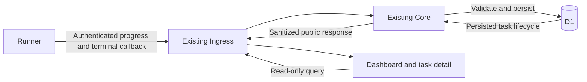

# Public review dashboard

Implementation specification for #163. Dashboard reads use D1 only; repository
metadata is refreshed independently in the background. Deployment and legacy
identity enrichment follow the rollout procedure below. Historical lifecycle
timestamps are not backfilled.

## Decisions and scope

- Reuse the existing Ingress and Core Workers and D1 database.
- D1 is the only data source for every dashboard page and public query, including
  repository identity. Dashboard reads never contact GitHub or Runner, enqueue
  metadata refreshes, or inspect in-memory jobs, processes,
  Sandbox inventory, logs or evidence archives.
- Runner proactively reports progress through the authenticated callback path;
  Core validates and persists it. Core alone determines the product outcome.
- The dashboard is public and read-only. Public repository identity can be
  displayed; private and unverified identity is removed on the server.
- Include current work, paginated history and permanent per-task detail URLs.
- Enrich legacy repository identity during implementation after verification.
  Do not backfill missing historical lifecycle stages or timestamps.
- No job cancellation, rerun, configuration editing, resource monitoring,
  log viewer, review-content viewer or login/admin interface in this scope.
  GitHub remains the place to request a rerun and read the published review.

The read path has no Core-to-Runner or Core-to-GitHub request. Repository
metadata is maintained independently in D1 by admission observations and a
scheduled handler on the existing Core Worker, as described below.

## What a task means

One task is one durable Core review run, not one webhook delivery or one PR.
Duplicate deliveries do not add tasks. An accepted retry after a failed run
gets a new run and URL, even for the same PR revision. Existing admission rules
still deduplicate active/completed same-revision work; this dashboard adds no
new ability to rerun successful reviews. Superseded runs retain their own history.
Ignored/rejected webhook events are not review tasks and do not enter public
history. Use the existing opaque run identity for routing; do not key URLs by
repository, PR, SHA, Runner job ID or the currently active job.

## Pages

### Presentation and language

Use IBM Carbon's components and layout conventions, with IBM Plex Mono for all
dashboard text, including headings, controls, tables, and Markdown Help. Serve
font assets from the dashboard's own origin. Use the installed Carbon Svelte
version's APIs and styles rather than assuming parity with newer React examples.
Keep navigation usable on desktop and mobile, use named table columns for review
lists, and retain visible keyboard focus. Follow Carbon's spacing, density, and
theme conventions consistently rather than combining multiple design systems.
Keep main pages focused on tasks, status, timestamps, filters, and actions.
Put explanations of URL filters, refresh mechanics, and historical gaps in the
Markdown Help page rather than adding explanatory banners to every page.

User-facing labels do not rename database states. Display claimed work as
"In progress" and a terminal timestamp as "Finished". Progress updates and page
refresh timestamps must remain distinct. Anonymous identity does not prove a
repository is private; it can also mean public visibility is unverified or expired.

While cleanup is pending, display "Cleanup after review" for scheduled work before
the reported cleanup stage, "Cleaning up" at that stage, and "Cleanup pending"
after the review has ended. Normal pending cleanup is muted; failed cleanup and
terminal pending cleanup remain visible exceptions. These labels describe recorded
state and do not assert that a process is currently alive. Failure wording must
preserve uncertainty: an unconfirmed publication is not proof that nothing was
published.

### Overview and current work (`/`)

The shared header shows the product name, navigation, last successful refresh,
and a manual refresh control for the current data page. Help has no refresh
control. The footer links the commit embedded at build time.

Four counts show Queued, In progress, Published and Failed. Queued means
`scheduled` with no Runner assignment; In progress means `scheduled` with a
Runner assignment and includes preparation, review and publication. It does not
prove that a process is currently alive. Published and Failed count reviews
received in the past 24 hours, using `created_at` even for legacy records with
unknown terminal times. Counts come from SQL aggregates, not loaded table rows.
Do not display a hard-coded capacity or equate assignment with occupied slots.

Show in-progress reviews first, then queued reviews oldest first. The Review
column contains identity; Status contains the same named status used by filters
and counts, with a recorded phase beneath it for unfinished reviews. Received
has its own column. Do not repeat terminal status and receipt time beneath the
identity. Public rows link to their PR; private or unverified identities remain
Anonymous review. Pages contain 25 items with an explicit link to full history.

Progress timestamps are observations, not heartbeats. Do not invent failure or
remove a review because a stage has not changed recently. Do not promise queue
position, estimated start time, or claim that elapsed age is model execution time.
Resource cleanup is technical detail, not a primary count, table column, or filter.

### History (`/history`)

Show newest admitted reviews first, with six Status choices: All statuses,
Queued, In progress, Published, Failed, Superseded. Queued and In progress use
the exact same database predicates as the public dispatch projection. Published
means successful publication, not an absence of findings. Superseded is not a
failure. Date filters select when the review was received, inclusive UTC dates.

Keep visible filters in the URL. Obsolete view/cleanup/combined-active UI filters
normalize to the current visible choices and discard their scoped cursor; never
leave invisible filters applied. The API retains its existing view/cleanup/active
queries for callers. No repository suggestions, private grouping or identity search.
Use a stable `(created_at, run_id)` cursor with validated filter scope. Changing
a filter resets the cursor. Older pages retain their cursor during refresh.
An unfinished review may leave a filtered list when its state changes.

### Task detail (`/jobs/<opaque-run-id>`)

Use the same identity and status labels as the list. Show a concise summary,
recorded timeline, received/assigned/finished times, queue wait and total duration
when endpoints exist. Assignment is not proof that execution started. Public
tasks link to their GitHub PR; do not fabricate a published review URL.

For public identity, show the recorded revision: **Source branch** (head) and
**Target branch** (base), then the **Reviewed commit** (head SHA) and **Base
commit**. A branch name not recorded at admission says Not recorded; never fetch
or invent it. These facts are withheld entirely for anonymous identity, exactly
like the repository name and PR link.

Use shared phase labels: Fetching code, Preparing environment, Reviewing,
Saving run records, Finishing up, Processing result and Publishing. The timeline
shows recorded milestones, not percentage progress. Missing records say Not
recorded; stages that never ran are not invented. Failures expose only safe
categories and finite messages, never raw exceptions. Unconfirmed publication
must not claim the review was never posted.

Put execution observations and cleanup state in a collapsed Technical details
section. `submissionCompletedAt` is labelled Result checks started: the Runner
records it after its archive attempt, before checking process exit and output;
it is not proof of submission, validation or Core receipt. Cleanup failure still
remains visible when it caused the product failure. Supersession can precede
cleanup and both facts remain inspectable.

A missing task has a neutral 404 page. Initial load failure must not claim old
data is visible. Refresh failure with retained data shows its freshness notice.
Use Retry for failed loads and Refresh now for deliberate refresh. Returning to
history preserves visible filters and scroll position.

### List and detail navigation

Selecting a review in Overview or History opens its detail beside the list
rather than replacing it. Desktop uses a nonmodal side panel (role `region`) so
the list stays directly clickable and the selected row stays visible; the list
drops its Received and Pull request columns while the panel is open because the
panel shows those facts. Narrow or intermediate widths where both cannot fit use
a full-screen panel (role `dialog`, focus contained) with explicit previous and
next controls so switching does not require closing. Mobile shows its own
Refresh now and Last updated in the panel because the shared header is covered.

Selection is client state, not a new route: the panel uses shallow history
(`pushState` for the first open, `replaceState` for later switches) so the
canonical list URL keeps its filters and page, Back closes the panel, Forward
reopens the last selection, and Close or Escape returns focus to the selected
row without moving the list. While a panel is open, the shared refresh control
targets the panel; when it closes, refresh returns to the list. A **Open full
page** link keeps the permanent `/jobs/<opaque-run-id>` URL shareable. Plain
clicks open the panel; modified clicks and new-tab keep the full-page link.

### Presentation and accessibility

Use SvelteKit file-based routes and Carbon Svelte components with IBM Plex Mono in
`apps/dashboard`. Build a client-rendered static shell with `adapter-static`;
the existing Ingress Worker serves it and its assets through the `ASSETS`
binding. No additional server or deployment service is needed. Components
render typed public DTOs, with shared refresh behavior; do not assemble HTML
strings or include task data in the build output.
Tables preserve readable column widths and scroll horizontally inside their
container on narrow screens. Statuses have text in addition to colour. Use semantic headings, labelled controls,
keyboard-visible focus and accessible timeline markup. Display relative times
with absolute dates and timezone available. Do not announce every polling tick
to screen readers; announce meaningful errors and status changes without
stealing focus. Refresh patches data without closing expanded rows, resetting
filters or scrolling. Provide explicit loading, empty, stale and error states.

## Database lifecycle model

Keep the existing product status (`scheduled`, `completed`, `failed`,
`superseded`) authoritative. Do not replace the queue state machine for the UI.
Expose separate execution progress and cleanup facts:

| Dimension         | Values / owner                                                                                         |
| ----------------- | ------------------------------------------------------------------------------------------------------ |
| Product outcome   | Existing status; Core only                                                                             |
| Dispatch          | Queued or claimed, from durable assignment and claim timestamp                                         |
| Execution stage   | Checkout, Sandbox preparation, reviewing, evidence archival, cleanup; reported by the owned Runner job |
| Result processing | Callback received/validated, publishing; persisted by Core                                             |
| Cleanup           | Existing pending/destroyed/failed, with unknown for historical null                                    |

"Published" means Core durably recorded successful publication, not model exit
0, submission, Runner success, cleanup success or a received callback. A
claimed run without a progress report says "Awaiting first progress update".
If Core has a valid result but publication is unfinished, say "Processing
result" or "Publishing" according to the persisted transition.

Add the following data where the current schema cannot provide it. Names are
logical; keep migrations aligned with repository naming conventions:

| Data                                                          | Purpose and write rule                                                                                                                                                      |
| ------------------------------------------------------------- | --------------------------------------------------------------------------------------------------------------------------------------------------------------------------- |
| `claimed_at`                                                  | First successful claim time for the recorded attempt, written in the atomic claim                                                                                           |
| `terminal_at`                                                 | First product-terminal transition time, immutable under duplicate callbacks and later cleanup                                                                               |
| `progress_sequence`, `progress_stage`, `progress_received_at` | Latest accepted Runner snapshot for the exact current run/job/attempt                                                                                                       |
| `progress_milestones`                                         | One optional start per stage in the explicit execution-stage enum below; no raw event log                                                                                   |
| Branch ref snapshots (`base_ref`, `head_ref`)                 | Nullable source/target branch names captured at admission from the validated automatic event or manual/Check-rerun PR facts; additive and never fetched or backfilled later |
| `result_received_at`, `publication_started_at`                | Core processing milestones at actual accepted transitions                                                                                                                   |
| `failure_phase`, `failure_reason`                             | Optional finite sanitized categories when a failure is known                                                                                                                |
| Visibility/provenance fields                                  | New source snapshot and separately verified legacy eligibility described below                                                                                              |

The execution-stage wire enum is exactly `checkout | sandbox | agent | evidence |
cleanup`. Labels are "Checkout", "Preparing sandbox", "Reviewing", "Archiving
evidence", "Cleaning up". Report on entry to the corresponding Runner operation;
`evidence` is a new explicit reporting transition at the start of archival.
`admission` belongs to Core dispatch, not this enum. The existing execution and
failure schemas need explicit mappings, not a wholesale rename: for example
execution `agent` maps to the label "Reviewing", while `output_validation` is a
failure phase rather than a new progress stage. Keep failure categories distinct.
One optional timestamp per enum member supplies the structural milestone bound.

Implement terminal_at at every product-terminal write: the queued-run supersede
inside `claimReview`, `markSchedulingFailed`, `markRunCompleted`,
`markRunSuperseded`, and `completeRunPublication`. Set it once with the guarded
terminal transition (`COALESCE(terminal_at, occurredAt)`), including early
pre-handoff failures. Set claimed_at in `claimNextJob`'s atomic assignment and
any supported direct assignment path, not later when the Check is updated.
Test each public transition, not just the successful callback path.

Reuse existing `created_at`, Runner assignment, cleanup and callback evidence
metadata. Do not treat mutable `updated_at` as an end time. Existing
`executionStartedAt` includes preparation. `submissionCompletedAt` is currently
set after archival and before validating success; it is not model submission
time. `cleanupCompletedAt` is written even on cleanup failure. Label these
legacy observations honestly; require `destroyed` to claim successful cleanup.

New lifecycle fields are nullable for old runs and old Runner versions. No
historical timestamp/stage reconstruction, synthetic backfill or reading raw
archives to fill gaps. A new stage snapshot is bounded data on a run, not a
generic event store. Reported times and Core receipt times remain distinguishable;
sequence establishes order, not clock agreement. If time endpoints are missing
or inconsistent, omit the derived duration rather than show negative or
fabricated timing. A long-unchanged stage is not evidence of Runner failure.

## Progress ingestion and ordering

Add an exact authenticated progress route alongside terminal callbacks in the
existing Ingress/Core path. Reuse the established Runner callback authentication
and private Core binding. It accepts only a small strict schema: run ID, Runner
job ID, attempt, monotonic sequence, execution stage and bounded cumulative
stage-start milestones. It contains no review text, repository identity, token,
stdout/stderr or arbitrary error message. Apply a schema-derived small body bound.

Runner emits on actual stage transitions, not every model token or dashboard
refresh. Keep at most one progress request in flight per job; coalesce queued
snapshots to the newest cumulative snapshot. Apply a short timeout (2 seconds)
to each send and no unbounded retry queue. A missed report can be recovered by
the next snapshot. Best-effort progress failure must not stop execution, delay
cleanup, occupy a slot after normal finalization, or suppress terminal callback.
The final authoritative callback includes the cumulative lifecycle snapshot so
ordinary missed progress does not permanently lose the timeline. Old callbacks
without it remain valid during rolling deployment.

Core atomically accepts progress only for the recorded run/job/attempt and only
when the sequence advances. Validate stage order and immutable earlier milestone
values; stages may be skipped on early failure. Duplicate/stale snapshots are
no-ops. Identity mismatch is rejected without modifying either owner. A sequence
number alone cannot authorize a stage regression or overwrite a terminal run.

Runner execution progress is separate from Core result processing: a delayed
execution report cannot move a run from publishing back to reviewing.
Progress cannot set product terminal status, claim publication, declare cleanup
destroyed, or mark a failure recovered. After a product terminal transition,
ignore live progress; the established identity-checked terminal evidence path
may still fill missing lifecycle evidence and confirm cleanup independently.
Supersession and delayed callbacks must not resurrect scheduled state. Terminal
callback processing and progress updates use conditional DB writes so either
arrival order yields the same final product state and preserved cleanup facts.
No new dashboard-triggered retry, cancellation or orphan reconciliation.

## Refresh mechanism

Use adaptive HTTP polling on both lists and details:

| Observed DB state                                     | Delay after the preceding request completes |
| ----------------------------------------------------- | ------------------------------------------- |
| Relevant scheduled/processing work or pending cleanup | 15 seconds                                  |
| No active work, or a settled terminal detail          | 60 seconds                                  |
| Consecutive failures                                  | 30, 60, 120, then at most 300 seconds       |
| Hidden tab or offline                                 | Pause; refresh on return/reconnect          |

Apply small positive jitter (up to 10%) to automatic requests to spread load.
Successful requests reset backoff. Honour a longer valid `Retry-After`, including
on focus/manual refresh. Use one in-flight request per page, a 15-second browser
request timeout, and cancellation/response identity checks on route changes.
Manual refresh shares the same mechanism. Terminal pages keep refreshing because
cleanup, late evidence and disclosure eligibility can still change.

Show last successful refresh and distinguish stale data from an empty result.
On failure preserve non-identifying operational context, clear repository
identity, and offer retry. Do not put responses in localStorage/IndexedDB.
Client-side elapsed clocks may tick without implying a new server observation.

First version uses small JSON responses with `Cache-Control: no-store`. Keep
state only in memory and do not add ETag/revision counters, websocket or SSE
infrastructure. Adaptive polling is sufficient for the expected small pages;
conditional requests can be evaluated later if transfer cost is measured.

## Repository metadata and disclosure

### Persist identity once, share it across runs

Store a repository metadata row keyed by `(installation_id, repository_id)`:
current verified `full_name`, visibility (`public | private | unknown`),
`verified_at`, `identity_expires_at`, and the small revision/refresh bookkeeping
needed for conditional updates. Renames update this row, so historical links
follow the same stable repository ID rather than an old name reused elsewhere.
Names and internal IDs stay server-side unless the disclosure rule permits them.

Each run separately retains `repository_visibility_snapshot` from the validated
automatic event or manual/Check-rerun PR facts. This is source-time visibility,
not proof of the exact database-insertion-time visibility. A legacy run with no
snapshot can instead carry explicit verified-public eligibility/provenance from
the requested historical enrichment. Never default a missing snapshot to public
or overwrite a known private snapshot. Known-private runs remain anonymous even
if the repository later becomes public.

Populate metadata from existing authoritative repository reads during review
preparation, extending the repository response schema to include `full_name`
and visibility rather than making an extra name request. A new admitted run
also ensures its repository is eligible for the independent refresh pass, so
queued work does not wait for claim before its name can appear. Insert a missing
metadata row as unknown with null name/verification/expiry. Do not reset an
existing fresh row on each admission, and do not treat a public source snapshot
as a verified-public metadata observation. Admission does
not wait for a new GitHub request solely to furnish the dashboard; until verified,
the task is visible anonymously.

### Maintain metadata outside the read path

Use a Cron Trigger on the existing Core Worker, once per minute. Query known
repositories with retained runs whose refresh is due, ordered by persisted
`next_refresh_at`. Successful verification schedules the next check two minutes
later. Failures also advance next_refresh_at (respecting throttling) so repeatedly
failing repositories cannot starve other rows by remaining oldest forever.
Refresh each repository once for all its runs, not once per task or visitor.

Choose each invocation's batch as `min(due rows, safe invocation capacity)`,
across all installations together. Safe capacity is bounded by available Worker
subrequests, the remaining invocation time, and the three-request concurrency
limit at measured latency (including token-provider requests and overhead).
Stop dispatch before those limits; do not infer throughput from batch size or
assume overlapping Cron invocations add capacity. Verify the deployed platform's
Cron execution/time/subrequest limits and behaviour during implementation.

Inventory sets demand, not capacity: the two-minute target requires roughly
`N / 2` completed repository checks per minute and `30 * N` per hour, summed
across installations. Compare that demand with measured end-to-end throughput,
the shared invocation ceiling, and each installation's actual available GitHub
quota after existing review traffic. Even the five-minute expiry alone requires
at least `12 * N` checks/hour without scheduling/retry margin. A computed large
batch does not make an unsupported inventory feasible.

Before enabling the dashboard, measure those limits and count distinct
repositories including historical enrichment; verify one full refresh cycle with
scheduling/retry headroom meets expiry. The five-minute privacy bound must not
be silently lengthened to accommodate capacity. If the inventory/quota cannot
support it, report that concrete rollout limitation rather than shipping normally
anonymized public history. At runtime, expose overdue metadata counts in operational
logs; quota or scheduler failures still expire identity safely. No per-page demand
queue or scan of installed repositories with no review history.

A short conditional per-row refresh claim prevents overlapping invocations or
admission refreshes duplicating work; it expires after the bounded request
window. This is metadata-refresh bookkeeping, not a general-purpose job system.
On GitHub rate limiting, stop dispatch for the current metadata invocation and
persist a refresh-only next-allowed time from reset/Retry-After. Subsequent Cron
invocations honour it before dispatch; advancing only the failing row would not
stop requests to the same throttled service. Already in-flight work remains
bounded. This single cooldown is not a per-viewer quota counter and does not
change review capacity or publication behaviour. Failures retain the previous
observation without extending its expiry; a conclusive private/deleted/inaccessible
observation removes public eligibility immediately. No global per-viewer token
counter or speculative fixed IP limit is introduced.

Existing signed, allowed-installation webhook observations that show a private
repository invalidate public metadata immediately; installation/repository access
removal notifications handled by this slice invalidate matching metadata as well.
A public webhook may mark metadata due but cannot renew verified-public lifetime
or undo a private observation: delayed deliveries must not re-expose identity.
Do not assume new repository-event subscriptions already exist; periodic checking
is the independent baseline. On webhook invalidation atomically set visibility to private/unknown, clear
public name/expiry, and increment metadata revision in the same write; incrementing
the revision alone does not revoke disclosure. A refresh started before that
revision must not overwrite it. Publish refresh
results only for the exact claimed revision, and establish freshness from request
start time so a delayed response cannot acquire a new full lifetime.

### Disclosure freshness is explicit

Verified-public metadata has a **five-minute maximum lifetime**. The server
returns name, PR number/link, branch refs and base/head SHAs only if the run is
eligible (public snapshot or verified legacy eligibility), metadata is public,
and it has not expired. Otherwise it
returns anonymous identity and an opaque task ID; the UI labels this "Anonymous review",
with no repo/installation ID,
PR number/link, SHA, branch name, actor, title, evidence identifier, raw error, log
or review content. Use the same projection for rows, detail, filters, HTML and cursors.
Do not expose stable pseudonyms that group anonymous runs by repository.

This is bounded-staleness disclosure, not synchronous GitHub authorization.
A public repository that becomes private may remain labelled until an observed
invalidation or expiry, at most five minutes after its last verification.
Name this limit in the operational documentation; never claim immediate
revocation. Already disclosed information cannot be retracted from a reader.
An outage lasting beyond expiry hides identity but preserves DB-backed task
counts, milestones and outcomes. Normal browsing consumes **zero** GitHub calls.

Return identity expiry and server time with public identity. The browser also
removes expired names/links independently of successful polling, checking again
before rendering on tab resume (hidden-tab timers can be suspended). A refresh
error clears identity conservatively. Browser clock skew must not extend the
server-provided remaining lifetime; use the relative server lifetime and elapsed
monotonic time conservatively. No public identity is cached in CDN or persistent
browser storage. Background refresh failure is not a task failure.

## Historical enrichment (implementation-time work)

The user requests enrichment of existing reviews, which are believed to have
run on public repositories. Perform this during implementation/rollout, not
while designing. Inventory distinct repository IDs from existing runs and verify
current identity and visibility through GitHub. Reuse each verified lookup for
the corresponding legacy rows. Never bulk-mark all history public on assumption.

For legacy rows with no source snapshot, record the verified-public eligibility
and verification time separately from the original source visibility. This
records that historical disclosure was enabled after a current public check;
it does not claim the repository was public when the run was created. Never
override a known private source snapshot. Private, inaccessible, deleted or
otherwise unresolved repositories remain anonymous. Store the verified current
name/visibility in the shared metadata row. Later display uses the same DB-only
expiry/disclosure rules as new runs, without another visitor-triggered lookup.

Make the operation repeatable and limited to missing legacy eligibility. Report
verified/enriched/unresolved counts. Do not alter statuses, immutable revisions,
cleanup evidence or timestamps to make historical timelines appear complete.
No production data has been read or changed for this design addition.

## GitHub status links to individual tasks

Each product-created **Petit Chiba Review Check Run** will carry a `details_url`
pointing to `<dashboard-origin>/jobs/<opaque-run-id>`. Use the durable Core run
identity so queued work already has a valid page before a Runner job exists,
and the same page remains valid after completion. An accepted retry after failure has its own run and
URL; a superseded run's URL continues showing that original run, never redirects
to the latest PR run. The URL contains no repository name, PR number, SHA or
credential. Private-repository links lead to the same anonymized public view;
coming from GitHub is not authorization to reveal identity.

Configure the canonical dashboard origin at deployment. Set the link when
creating a Check and PATCH it when recovering an existing matching Check;
queued/running/terminal update payloads carry the same target. Omit external
links when no canonical origin is configured rather than constructing a wrong URL. Keep `external_id`
bound to the run. Add a visible task link in Check output as well, so the
external navigation is discoverable even on GitHub surfaces that first open
GitHub's own Check page. Do not promise that every GitHub click bypasses its
native UI: `html_url` remains GitHub-owned.

The current adapter already creates a per-run Check with `external_id=runId`,
but does not send `details_url`. GitHub supports that field on Check creation
and update with the existing Checks write permission. This covers our review
checks, not arbitrary GitHub Actions jobs or checks owned by other Apps. Legacy
commit statuses have the analogous `target_url`; this product does not need to
introduce a second status mechanism.

Sources checked 2026-10-16:

- [GitHub Check Runs: create/update](https://docs.github.com/en/rest/checks/runs)
- [GitHub commit statuses](https://docs.github.com/en/rest/commits/statuses)

## Read interfaces and infrastructure

Add explicit GET routes for the page shell and dashboard APIs before Ingress's
existing non-POST rejection. Other paths retain their current method/auth rules.
Serve the page shell and routes through existing Ingress. Exact read-only JSON
routes expose overview/current work, paginated history and one task detail.
Core owns SQL queries, public projection and state interpretation; browser code
receives only the public representation. Detail and list use one projection so
an anonymous row cannot leak through a deep link. Return stable opaque task IDs,
outcome, persisted stage/milestones, cleanup, safe failure categories, optional
public identity and pagination. Do not expose raw ReviewOutcome or diagnostics.

Every public read queries only D1, including repository metadata. It must make
zero requests to either Runner or GitHub and must not enqueue external work.
GitHub/model/Runner outages cannot make a healthy D1 dashboard request fail;
identity expires independently. A failed DB query returns 503, not invented
counts. Read aggregate counts and rows consistently within a request using
D1-supported batch/transaction semantics. Add `(created_at, run_id)` pagination
and appropriate status/date indexes, verifying query plans against representative
history instead of creating redundant indexes for every UI filter.

Keep Worker and Runner credentials server-side. Reuse existing Workers and add
only the Core metadata Cron Trigger and a `scheduled` handler on its existing
default export (currently fetch-only). Update entrypoint typing as needed.
No new service, websocket, Durable Object,
generic scheduler, resource agent or frontend service. Document the Cron in both
the tracked config (`triggers.crons`) and deployment renderer, preserving existing
Worker bindings and Durable Object migration history. Existing review webhook, terminal
callback and claim authorization remain unchanged. Metadata event handling uses
the same HMAC and installation authorization, including negative removal events
for already known installations, without creating a review task.

## Implementation slices and rollout

1. Persist shared repository metadata and run visibility/provenance; implement
   bounded background refresh/expiry and DB-only public overview/history/detail
   queries with strict anonymous projection and privacy regression tests.
2. Add prospective lifecycle fields, atomic claim/terminal times and authenticated
   progress snapshots, including callback recovery, ordering and ownership tests.
3. Build the responsive dashboard and deep-linked detail page, filters/timelines,
   adaptive refresh and GitHub per-run Check links.
4. Run the explicitly requested legacy repository verification/enrichment;
   retain unknown lifecycle gaps. Verify counts and representative detail pages.
5. Deploy additive migrations, metadata Cron and compatible Core/Ingress before the newer
   Runner. Older Runner callbacks and existing scheduled jobs must remain valid.
   Restart Runner only after normal drain, preserving concurrency 6, runtime,
   model and credentials. Activate public links only once their routes work.

Use behavior-based TDD at public Worker HTTP/Runner process/store query seams.
An independent review must cover the final implementation, not merely this
proposal. Required checks: repository format/lint/types, relevant behavior tests,
full suite/build and browser verification; production read-only checks confirm
routes, privacy, existing history, Check links and a real task's DB-driven
progress when one naturally runs. Do not manufacture a review solely for UI
screenshots. Report unobserved production lifecycle acceptance honestly.

## Acceptance criteria

- Dashboard and detail reads make zero Runner AND GitHub requests and schedule
  no external work. Persisted state remains readable during their outages;
  missing progress is not fabricated failure. Every claimed row/detail shows
  last-report age without claiming liveness, including a simulated crashed Runner.
- Automatic, manual and Check rerun admission capture source visibility. Legacy
  enrichment has distinct provenance and cannot override a known private snapshot.
- Private/unverified/expired identities are absent from complete API/HTML,
  cursors, filter options and details. Public-to-private handling respects the
  documented five-minute bound and immediate observed invalidation. Background
  failure never renews expiry. No raw logs, evidence or review content leaks.
- Duplicate webhook deliveries count once; reruns have separate pages and links.
  Equal-time pagination and incoming work do not duplicate or skip stable rows.
- Valid stage reports become visible via a fresh Worker instance reading D1.
  Duplicates, reordering, malformed bodies, false ownership, terminal races and
  failed report transport cannot regress state or interfere with terminal cleanup.
- Final callbacks recover missing prospective milestones. Legacy fields remain
  unavailable; no lifecycle backfill runs. Publication success is distinguished
  from execution success and pending/failed cleanup remains independently visible.
- Lists/details refresh automatically, including settled tasks. Verify single
  flight, backoff/reset, jitter bounds, Retry-After, visibility/offline pause,
  navigation races and preservation of keyboard focus, scroll and filters.
- Every product Check targets its own durable job page throughout its lifecycle;
  a recovered/delayed Check and a new rerun retain the correct separate run URLs.
- Responsive layout, keyboard navigation, readable timestamps, neutral missing-job
  page, empty data, partial identity, stale data and DB outage are verified in a
  real browser. A failed read never shows a fabricated zero queue.

- Multiple viewers/tabs and detail polls cause no added GitHub work. Background
  refresh deduplicates repositories, respects batch/concurrency/timeouts and
  throttling, and updates all corresponding run displays through one metadata row.
  An older in-flight public response cannot overwrite a newer private observation.
- Names survive ordinary polls from fresh DB metadata and disappear after expiry
  during an outage, including offline/hidden-tab/resume and clock-skew cases.
  Recovery re-exposes only currently verified public, eligible runs. Verify the
  required Cron config is rendered and the expected inventory fits its cadence.

- All five terminal-write paths persist terminal_at once; early failure and queued
  supersession are covered. Metadata invalidation atomically removes disclosure;
  initial admission is unverified while fresh existing metadata survives admission.
  Failing repositories do not starve refresh of other repositories.

- Metadata dispatch respects one global invocation capacity across installations
  and available per-installation quota. A throttle stops new dispatch and persists
  cooldown across Worker instances; it does not issue the rest of the due batch.
